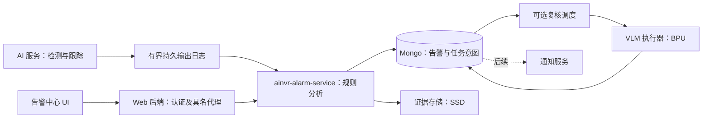

# AINVR 告警微服务后端设计与前端对接契约

版本：设计 v1.1，2026-10-19。状态：开发设计，非已实现/已部署声明。v1.1 补充系统配置统一应用与仪表盘接入。
配套：[告警中心 UI 与交互设计](ALARM-CENTER-UX-DESIGN-20261019.md)。本文件固定服务职责、状态、数据、接口和验收；配套文件固定页面交互。冲突时以用户最新要求为准。

## 1. 用户目标、约束和本期完成定义

### 1.1 业务链路

输入 SRS 通道 → AI 处理器检测 → 跟踪和轨迹 → 行为分析 → 告警落库及列表 → 可选 VLM 复核 → 人工查看/确认。未来另加通知服务决定发送短信等。

用户要求分成告警分析、告警复核（可关闭）、告警列表/日志；单条和批量确认均用独立弹窗。每条告警占一行，兼顾 iPad 触屏及键盘鼠标。告警复核是候选事件产生之后的核实，不是每个检测帧必经步骤；也不替代跟踪器和几何规则。

### 1.2 硬约束

- 接入管理独占 SRS 通道创建；告警服务不能创建输入/输出流，不能恢复用户删除的试用流。
- 不复制检测器，不重做成熟跟踪器。不同检测模型通过统一帧/轨迹契约输入；模型专属解析留在 AI 适配器。
- 预测轨迹与观测轨迹显式区分。卡尔曼预测用于关联和短时显示，不能独自证明进入、穿越或真实碰撞。
- 人工确认、模型复核、行为结束相互独立；没有置信度的模型保留 null。
- 录像优先；复核拥塞不能阻塞录像、检测和轨迹输出。生产神经网络推理用 S100P BPU HBM，不静默切 CPU/GPU。几何规则和业务调度是普通 CPU 逻辑，不属于神经网络回退。
- 大图/模型/队列文件放 SSD；容量和故障可观测。凭据不进入文档、浏览器或事件内容。
- 保留历史及现有用户配置；不自动开启旧规则、旧通知、旧 VLM 任务，不自动发送历史告警。
- 本次仅设计文档，不提交/推送、不部署或切换运行服务。

### 1.3 完成边界

第一交付闭环：关闭 VLM 也能从真实跟踪输入触发规则，持久保存事件及证据，在列表查看、筛选、单条/批量确认、查看日志，重启不丢确认、不重复告警。

第二交付闭环：经过兼容性和质量/资源验收的 VLM 可选择开启；复核成功、拒绝、无法判断、失败均可追溯，失败转人工。VLM 未就绪不阻塞第一闭环。

通知、流量报表、热图、物理碰撞推断、跨镜头身份关联、全量历史轨迹检索不在本期。流量统计未来复用可靠 crossing 事件，不按检测框数量计数。

## 2. 当前代码核查与差距

核查基线：远程仓库 HEAD `708e0c5`（第一阶段目标跟踪与实时轨迹显示），2026-10-19；仅源码核查，不等同现场验收。

| 当前文件/能力 | 核查结论 | 对接决定 |
|---|---|---|
| `srs-web-console/frontend/src/features/analyticsPhase.ts` | rulesAndEvents/review/notification 均 false | 不直接一并打开；逐能力验收 |
| `srs-web-console/frontend/src/router/index.tsx` | 没有独立告警中心路由 | 新增独立页面与错误边界 |
| `.../pages/AiChannels/AnalyticsEvents.tsx` | 通道内最近100条事件弹窗、卡片式、复核/通知状态，无人工确认流程 | 不能原样作为新告警列表；可复用状态展示、错误态经验 |
| `.../AnalyticsRuleEditor.tsx`、`AnalyticsReviewSettings.tsx` | 存在隐藏组件 | 只审查复用表单/几何交互，不自动沿用旧业务所有权 |
| `srs-web-console/backend/src/routes/aiProxy.ts` | Fastify 具名代理，已有服务认证配置模式 | 新增 alarmProxy，同样明确路径，不做任意 URL 透传 |
| `ai-service/src/analytics/*` | 已有 geometry/tracker/event_store/event_outbox/event_worker 等 | 复用经测试的几何与持久化思路，需逐项审计，不声称已满足新协议 |
| `ai-service/src/api/control_server.cpp` | 已有 analytics_events Mongo 读取及阶段门禁 | 旧记录只读兼容；禁止两个规则引擎同时产出正式告警 |
| 配置中心 PG / AI 归档 Mongo | 两种存储职责已存在 | PG 保持设备服务配置；告警业务集合使用 Mongo，避免双份规则真相 |

不把以前 review_status=approved/rejected 直接解释成人工确认；旧 notification_status 只作为历史事实显示，不启动任务。

## 3. 服务架构与职责



部署建议：独立 `ainvr-alarm-service`，不把业务继续塞进推理线程。语言优先复用现有 C++ 几何与 Mongo 基础，但这是建议实现选型；HTTP/JSON 契约与语言解耦。VLM worker 独立进程，隔离阻塞和模型内存。首版不新增 Kafka/Redis 依赖，使用有界 SSD 输出日志、Mongo 状态和任务租约。

模块：InputReader（排序/重放）、RuleRegistry（版本发布）、RuleEngine（纯几何与状态机）、EvidenceCoordinator（精确帧关联）、AlarmRepository（原子业务更新）、ReviewScheduler、AuditProjector、HTTP API、Health/Metrics。一个通道同一时刻仅一个持租约的规则消费者，避免状态分叉。

## 4. 统一输入协议与可靠性

### 4.1 FrameObservation v1 示例

以下为新契约示例，不是现有接口已返回的结构：

```json
{
  "schema_version": "1.0",
  "message_type": "frame_observation",
  "channel_id": "ai-gate",
  "input_stream_id": "stream-gate",
  "stream_session_id": "session-uuid",
  "seq": "1042",
  "frame_id": "session-uuid:1042",
  "source_pts_ns": "104200000000",
  "captured_at": "2026-10-19T06:32:08.000Z",
  "received_at": "2026-10-19T06:32:08.090Z",
  "source": {"width": 3840, "height": 2160, "coordinate_space": "source_pixels", "geometry_revision": "g3"},
  "model": {"id": "detector-id", "artifact_sha256": "hash", "label_map_version": "v2"},
  "tracks": [{
    "track_id": "37", "label_id": "person", "class_id": 0,
    "state": "confirmed", "observation": "detected",
    "bbox": {"x": 1200, "y": 500, "w": 240, "h": 700},
    "confidence": null, "last_observed_pts_ns": "104200000000"
  }]
}
```

ID、seq、纳秒值均作为字符串，避免 JS 精度损失。类别用语义 label_id+映射版本，class_id 仅诊断。轨迹唯一键是 channel_id+session_id+track_id。矩形是原始图像像素 xywh；规则存 [0,1] 归一化坐标。方向/裁切/旋转变化产生 geometry_revision，旧规则需重新确认。

空 tracks 是有效帧，不等于断流。控制消息显式支持 stream_started/stream_ended/gap/config_changed。source_pts 用于同会话运动时间；UTC 用于列表和布防时段；时钟跳变不制造运动事件。

### 4.2 日志、确认、重放

AI 输出通过独立有界写入线程追加 SSD 分段日志，含版本、长度和校验；规则消费者按游标拉批次，至少一次投递。生产者只有完成持久化屏障后才标记 durable。业务线程不等待 Mongo 或 VLM。

消费者处理顺序：读取 → 规则评估 → 幂等写告警/行为状态检查点 → 提交游标 → ACK 可回收范围。事件 ID 从确定性 episode_key 导出；episode_key 含规则版本、会话、目标、行为及 episode 首个有效 seq。任何崩溃点重放同一输入生成同一 ID。

行为状态检查点与游标同文档原子更新；告警可能先成功而检查点未成功，重放靠唯一 dedup_key 去重。不得先推进游标再写事件。状态检查点含有限活跃轨迹状态及生效规则版本，限制大小，必要时按通道分片；不能无限增长逼近 Mongo 文档上限。

乱序不按接收时间随意补算：等待有界缺号窗口，到期/不可重放记 gap 并重置相关行为状态。重放使用原始规则生效边界，不用当前规则覆盖旧历史。会话变更、PTS 回退、超长观测间隔、构图变更均断开连续性。

磁盘写失败或缓冲区满：AI 保持主通道运行，告警能力降级，记录丢失 seq 范围及健康错误；恢复后的首条消息携带 gap，不能宣称零丢失。有界存储意味着极端断连可能丢失，UI 必须显示不可恢复缺口。

只消费 latest/SEI 不合格：latest 会跳中间帧，SEI 可能裁剪载荷且偏向播放用途。

## 5. 规则结构与行为状态机

规则：id/version/name、source绑定、label selectors、behavior、geometry、anchor、thresholds、schedule/timezone、severity、review_profile_id/version、desired_state、effective_from(session/seq)。配置状态草稿/启用/暂停/归档与运行状态在线/离线/滞后/配置失效分开。

每次编辑产生不可变版本；启用需要模型标签映射有效、跟踪开启、行为能力验收、几何合法。发布返回目标版本及实际生效边界，UI 区分“等待生效”和“已生效”。停止规则结束当前 episode（reason=rule_disabled），不删除已有告警；旧复核继续按事件冻结策略执行。

| 行为 | 状态与触发 | 重新触发条件 |
|---|---|---|
| 出现 | absent → candidate → observed_confirmed，持续条件满足后发一次 | 明确失联超限后新 episode；起始已存在目标策略显式配置 |
| 接近 | outside_buffer → inside_buffer，持续满足，可选距离下降 | 离开外缓冲带及滞回后重新接近 |
| 接触 | disjoint → intersecting，符合选定框/锚点几何 | 分离并持续满足重置时长 |
| 进入 | 稳定 outside → 稳定 inside，观测连续 | 稳定退出后可再次进入 |
| 穿越 | 线段两侧的可靠观测，越过有限线段，方向符合 | 离开死区并稳定到另一侧后下一次穿越 |

接触是图像几何相交，不是物理碰撞；接近不宣称米距离。进入、穿越可以推知某种先前可见性，但不自动连发出现/接近/接触告警。若以后需要层级策略，必须明示组合条件。

锚点默认框底边中心（人员近似脚点），可选中心/框相交并冻结在规则中。所有持续阈值使用时间，不硬编码帧数。采样太稀疏则提示该规则证据不足；不能靠预测插值伪造高频观察。

试运行与正式分析使用相同纯规则引擎，但独立运行 ID 和内存状态，禁止写正式 alarms/outbox。输入窗口固定，输出命中和未命中原因、gap及规则版本；取消/超时释放资源。几何校验前后端一致：点数、范围、非零面积/长度、禁止自交、方向合法。

## 6. 事件模型与三条独立状态轴

```json
{
  "schema_version": "1.0",
  "alarm_id": "alarm-uuid", "dedup_key": "deterministic-episode-key",
  "channel_id": "ai-gate", "input_stream_id": "stream-gate",
  "stream_session_id": "session-uuid", "track_ids": ["37"],
  "rule": {"id": "rule-uuid", "version": 3, "name": "大门人员进入", "snapshot": {}},
  "behavior": "region_enter", "severity": "warning",
  "occurred_at": "2026-10-19T06:32:08.000Z",
  "last_seen_at": "2026-10-19T06:32:09.000Z",
  "lifecycle": {"state": "active", "end_reason": null},
  "review": {"state": "skipped", "reason": "policy_disabled", "attempt": 0},
  "handling": {"state": "unacknowledged", "revision": 0, "disposition": "unset"},
  "evidence": {"state": "pending", "refs": []},
  "version": 1
}
```

示例 snapshot 省略；生产必须保存完整规则及模型/标签/输入版本、触发观测帧和条件值。列表返回精简投影，详情再取快照/证据/日志，避免每行携带轨迹大数组。

- lifecycle：active/ended，确认不会结束行为；瞬时 crossing 事件可直接 ended。
- review：skipped/queued/running/supported/not_supported/uncertain/failed。未启用是 skipped，运行异常是 failed，不混用。attempt 记录每次复核。
- handling：unacknowledged/acknowledged，另有 disposition=unset/false_positive。模型结果不会写人工字段。
- evidence：pending/available/partial/missing/expired；缺证据不删除事件。

默认“待处理”：未确认、未标误报、复核不是 not_supported；包含 queued/running/uncertain/failed/skipped。全部记录可检索所有情况。人工标误报也记录确认人/时间及原因；撤销为新增审计动作，不删除旧日志。

## 7. Mongo、SSD 与原子性

建议独立集合前缀 alarm_，沿用现有连接配置机制但限定最小权限。配置中心 PG 只管理服务地址、认证、资源预算和部署配置，不同步另一份可写规则。

| 集合 | 内容/关键索引 |
|---|---|
| alarm_rule_versions | 唯一(rule_id,version)，不可变快照；当前版本指针独立文档 |
| alarm_review_profiles | 版本化策略和已验收模型引用 |
| alarms | 唯一alarm_id和dedup_key；(channel_id,occurred_at desc,alarm_id desc)及常用处理筛选复合索引 |
| alarm_consumer_checkpoints | 每通道租约、游标、有限行为状态、生效版本 |
| alarm_jobs | 唯一(alarm_id,kind,attempt)，state+next_run_at、lease_until |
| alarm_logs | 唯一operation_id；(alarm_id,time,operation_id)，追加审计 |
| alarm_bulk_operations | 幂等批次及每项结果、固定选择范围、授权主体 |

不得假定 Mongo 是副本集。首版按单文档原子操作设计：告警更新时同时写 pending_audit/pending_jobs（小且有界的意图），投影器幂等插入日志/任务，成功后清理意图。崩溃后可重放。意图队列超限拒绝新写并返回明确可重试错误，不提交无审计的确认。日志展示合并尚未投影的 pending_audit，避免刚确认看不到记录。成功返回须达到配置的持久化写确认，不能仅入进程内队列。

规则发布和当前指针使用 CAS；所有 worker 使用租约 token/fencing generation，过期 worker 不得提交结果。当前手动操作使用 handling.revision CAS，不因无关 review 更新制造确认冲突；结构编辑用 rule.version。

证据：引用 frame_id+PTS+原始尺寸+SHA256；同帧精确绑定，不用之后的实时截图替代。写入临时文件、校验并原子rename，状态再变 available。事件先可见、证据允许 pending；复核等待证据或超时转人工。

证据由 EvidenceCoordinator 维护 pin/lease，普通识别历史的 TTL 不得删除仍被告警引用的文件。无法取得原始帧时写 missing，不伪造匹配。复用既有图片硬件路径；普通截图归档关闭时，规则若要求证据，启用前必须具备独立事件截图能力，否则阻止启用或显式允许无图记录的策略。

告警/审计/文件保留期由产品设置，设计不偷偷设默认短 TTL。过期采用标记→解除引用→文件回收的可恢复步骤；日志保留删除原因。禁止仅对 Mongo 加 TTL 而遗留 SSD 文件，或反过来先删证据。

## 8. API 契约：直接支持当前 UI

外部路径统一 `/api/alarms/v1`，经 Web 后端具名代理；内部 `/v1`，服务仅内网访问。以下路径均相对该前缀。此约定细化配套文档中的概念路径，实施不得同时保留两套可写 API。

| 方法/路径 | 用途/关键行为 |
|---|---|
| GET /capabilities | 已实现且通过验收的行为、复核模型、权限和不可用原因；不返回虚假的可用能力 |
| GET/POST /rules | 规则列表/创建草稿 |
| GET /rules/{id}；POST /rules/{id}/versions | 读取/以 expected_version 创建修改版本 |
| POST /rules/{id}/activate、/pause、/archive | 显式转换，返回实际版本及生效状态 |
| POST /dry-runs；GET/DELETE /dry-runs/{id} | 有界试运行/读取/取消，无正式事件副作用 |
| GET/POST /review-profiles；POST /review-profiles/{id}/versions | 可选复核策略 |
| GET /events | 游标列表、精简字段、as_of时间；默认limit50，最大200为初始建议可调预算 |
| GET /events/{id} | 详情、快照、授权证据引用、allowed_actions |
| GET /events/{id}/logs | 审计游标分页 |
| POST /events/{id}/acknowledgements | 独立确认弹窗提交 |
| POST /events/{id}/dispositions | 标记/纠正误报，原因必填、权限校验 |
| POST /bulk-acknowledgements；GET /bulk-operations/{id} | 单批建议最多200显式ID，返回逐项结果；同一幂等key重试不重复执行 |
| POST /events/{id}/review-attempts | 人工重试，新增attempt，不覆盖历史 |
| GET /evidence/{id} | 授权图片/片段，路径不由客户端提供 |

单条确认请求示例：

```json
{"expected_handling_revision":0,"note":"已联系值班人员核实"}
```

请求头 `Idempotency-Key`；主体相同重复返回原结果，主体不同返回409。actor从认证上下文取得，禁止信任请求体用户名。备注按纯文本保存/展示，限制长度500字符；服务返回acknowledged_by/at、handling_revision、operation_id。已经确认返回already_acknowledged，不覆盖原操作者。

批量请求 `{items:[{alarm_id,expected_handling_revision}],note}`，返回operation_id及每项 succeeded/already_acknowledged/conflict/forbidden/not_found/failed。部分失败不是整批失败，也不能只弹“成功”；只重试失败项。首版只做本页/明确ID选择；“全部筛选结果”作为后续能力，未实现selection_token快照前隐藏入口。

列表排序 `(occurred_at desc,alarm_id desc)`；游标绑定筛选和as_of，防止新事件插入导致翻页重复/跳页。推送或轮询只提示“有N条新记录”，用户刷新才更新位置。过滤参数有白名单、查询范围和超时，不直接拼Mongo操作符。

错误结构 `{error:{code,message,field_errors,retryable},request_id}`。422字段错误、409版本/幂等冲突、403权限、503依赖未就绪/持久化失败；证据过期410。服务不可达与空列表不同。资源限流429给Retry-After。缺少未知行为支持时保存草稿可返回warning，但activate必须拒绝。

## 9. VLM 执行器与资源隔离

任务输入：alarm_id、attempt、profile/version、model id/hash、有限证据ID、明确复核scope、问题、输出schema、deadline。禁止任意本地model_path、网络URL和shell参数由浏览器直传。

复核scope区分 target_presence（对象存在）与 temporal_behavior（运动行为）。单图scope不得把“有人”解释为“越线成立”；UI同时显示scope和结论。输出：verdict=supported/not_supported/uncertain、reason、evidence_ids、limitations；无有效结构、截断/超时是failed。

任务先落库，worker lease领取；超时终止该attempt并隔离执行器，不能释放仍被BPU使用的内存。模型加载失败、证据不足、队列满、预算不足均显式转人工；晚到结果需验证attempt/token，不能覆盖更新结果。重试预算有界并记录，禁止无限重试。

首版串行review，检测/录像优先；常驻模型是否启用由实测Linux+ION余量决定，不以参数量推算。队列时延、推理耗时与冷加载分开。资源预算在配置中心管理，初始值须上板验证后定，不复用历史未确认的性能上限。

Qwen3-VL-4B 是用户允许下载测速的候选，不是已通过S100P验收的依赖。官方S600产物不能当S100P HBM；具体调研状态见UI设计第7节。模型未就绪时隐藏启用操作/显示原因，VLM关闭的告警链路仍正常。

## 10. 前端必须调整项

| 位置 | 必做调整 | 后端依赖 |
|---|---|---|
| AppLayout / router | 新增告警中心三页；列表默认；深链可打开事件详情；独立错误边界 | capabilities及授权 |
| AnalyticsEvents | 新建一行一条列表，避免旧多行卡片/100条固定截断；旧入口可跳转带channel筛选 | events游标、as_of、状态投影 |
| 确认操作 | 行内按钮仅打开独立弹窗；单条/批量共用，备注、数量、提交中禁重复、失败保留输入 | 幂等key、handling_revision、逐项结果 |
| iPad/键鼠 | 48px鼠标/56px触屏行高；44px点击区；any-pointer:coarse兼容外接鼠标；键盘焦点不因刷新丢失 | 稳定ID、可重试结果 |
| 弹窗 | 真正模态、焦点限制、Esc取消、关闭恢复；提交中Esc可关闭但明确后台结果可查，不伪称取消服务器操作 | operation_id |
| 详情 | 原图/局部图、轨迹/区域开关、规则快照、scope、日志；缺证据不以实时图替代 | evidence与snapshot |
| 规则编辑 | 从AI通道配置中分离；复用画布但适配归一化坐标、手指拖动、撤销、方向及版本冲突 | rules、dry-runs |
| 复核页 | 不暴露任意model_path；模型ID和可用性列表；跳过/失败/无法判断分开 | capabilities、profiles |
| 通知 | 本期隐藏配置、发送按钮及待发送计数；旧记录通知信息只读 | 无发送API |
| 阶段门禁 | 静态构建门禁与服务capabilities双重检查；直达URL也不能越过权限/能力 | 后端强制门禁 |

当前预览不是完整生产实现：全筛选批量、真实画布编辑、证据播放器、误报原因表单、错误恢复与权限均需实现。此次不修改生产前端代码，以免提前开放未完成能力。

## 11. 通知预留与历史兼容

未来通知独立消费已满足策略的告警，至少区分 supported/skipped/uncertain/人工覆盖；不可将“未确认”直接等同“未发送”。每收件人/渠道/轮次独立notification_job，唯一键去重、超时重试、回执留存。通知启用时间作为历史边界，默认不回发旧事件。

旧 analytics_events 保留原记录；只读适配器返回 legacy=true，未知字段显示未知。历史没有确认不能伪造已确认；如允许对旧事件确认，创建独立handling附属记录，不改写原始证据。旧规则仅可显式导入草稿，未完成验证不能自动启用。切换时禁止AI旧规则引擎与新服务双写；先影子试运行，再指定生效边界，失败恢复跟踪主链路。

## 12. 运维、验收与交付顺序

健康接口区分liveness与readiness；readiness包含Mongo可写、输入滞后、证据存储、规则加载，review可单独degraded而基础列表仍可用。指标：输入seq缺口、消费滞后、去重数、告警持久化时延、证据失败、review排队/耗时/超时、确认失败、outbox占用、SSD余量。日志带request/alarm/channel/session/operation关联ID，不记录访问密钥和整幅图像。

| 验收编号 | 必须达成的结果 |
|---|---|
| A01 | VLM关闭时真实观测→规则→事件→列表→确认→日志完整，通知零发送 |
| A02 | 相同输入重复/重放、事件写成功后进程崩溃，恢复不产生重复事件 |
| A03 | 缺号、断流、PTS回退、会话更换不凭预测补造穿越；显示gap |
| A04 | 几何方向、边界抖动、开始已在区域内、低采样率均有固定测试期望 |
| A05 | Mongo断开/SSD满时错误可见，恢复可重放；检测录像不被等待阻塞 |
| A06 | 精确帧证据关联，图片过期/缺失明确；保留期内不被普通归档清理 |
| A07 | 单条/批量确认幂等，部分失败可查重试；确认和审计可崩溃恢复 |
| A08 | 复核晚到不回滚确认；过期worker不覆盖新attempt；failed不等于skipped |
| A09 | 禁复核/无兼容模型/证据不足/排队满均按指定策略处理，不静默回退推理 |
| A10 | 规则旧版本、标签变更、构图变更有可追溯生效边界 |
| A11 | iPad横竖屏单行、44px目标、键盘焦点/Esc/备注Enter和批量冲突均测试 |
| A12 | 越权来源/证据、伪造actor、任意路径、查询注入被拒；列表错误不冒充空 |
| A13 | 部署前后原SRS绑定、录像、AI推流与归档基线无未解释退化；回滚可恢复 |

实施批次：P0输入契约与故障回放 → P1无VLM告警闭环+前端列表确认 → P2规则画布/试运行/更多已验证行为 → P3可选VLM上板验收。每批先离线固定数据、再隔离命名空间、最后有限现场验证。没有通过对应验收的能力保持隐藏且API拒绝，不以页面可点或接口返回200作为完成。

交付物：版本化JSON Schema/OpenAPI、迁移/回滚脚本、固定测试片段和期望结果、故障注入报告、iPad/键鼠交互检查记录、上板资源基线、运行手册。实现前确认Mongo拓扑/写确认配置、现有事件outbox覆盖能力及证据pin接口；这些是技术核查项，不自动转为要求用户重复授权。

## 13. 系统配置：告警微服务配置页（用户补充，必做）

### 13.1 信息架构及参数归属

在现有“系统配置”分类中新增 **告警微服务配置**，建议紧邻 AI 微服务配置，描述“服务连接、存储、处理队列与复核资源”。路径 `/config-center?category=alarm-service`，沿用现有表单、保存按钮、应用遮罩、状态反馈与未保存提示，不另建设置中心。

配置应用状态区域同时新增“告警微服务”卡片，服务标识统一 `alarm-service`，进程名 `ainvr-alarm-service`。显示目标版本、实际已应用版本、最近确认时间及错误原因；两版本不一致时不能仅显示一个“配置版本”造成已生效误解。未安装、等待应用、等待重启、正在重启、已应用、应用失败、状态未知必须可辨；未安装不得冒充正常或自动开启业务。

| 参数归属 | 所在页面 | 说明 |
|---|---|---|
| 告警服务地址、服务鉴权、请求超时 | 告警微服务配置 / 连接 | 浏览器经BFF访问；不暴露明文密钥 |
| Mongo连接、数据库名、连接/写确认参数 | 数据库配置 / 告警业务库 | 新增明确分组，支持现有Mongo实例但独立业务命名空间和权限；告警配置页仅显示摘要与跳转 |
| SSD证据目录、配额、保留期、最小余量 | 告警微服务配置 / 存储 | 参数配置不等于允许立即迁移/删除历史文件 |
| 输入日志/消费预算、证据等待、积压阈值 | 告警微服务配置 / 处理 | 资源上限和运维策略；生产者日志参数若属AI服务必须标明联动影响 |
| VLM并发上限、内存预算、全局队列/超时/重试上限 | 告警微服务配置 / 复核资源 | 全局约束，不等于启用任何规则的VLM；策略不能越过上限 |
| 区域、线、目标、行为阈值、时段、级别 | 告警中心 / 告警分析 | 业务规则，不混入系统参数表单 |
| 模型选择、问题模板、证据范围、跳过/转人工策略 | 告警中心 / 告警复核 | 版本化业务策略，受系统资源限制 |
| CPU/内存/积压趋势、状态和日志 | 仪表盘 | 展示与跳转；不复制一套可写参数 |

同一参数只有一个权威字段和编辑入口，不在数据库页和服务页保存两份Mongo URI。DB字段可以存于PG中的alarm-service配置文档，由数据库分类呈现；页面分类不决定配置所属服务。BFF连接配置归backend，告警运行参数归alarm-service，秘密引用按各服务命名空间分配，不能跨服务读取秘密；需要同一认证材料时通过受控配置编排更新双方专属引用。

### 13.2 表单字段与校验

连接组：服务地址（受控内网/合法协议）、鉴权状态“已设置/未设置”、替换密钥输入、访问超时、测试连接。测试连接只返回可达性/鉴权/版本，不发布配置、不重启；测试通过不代表保存应用成功。密钥空白默认保留，清除需独立显式操作。

存储组：证据根目录、证据配额GiB、最小剩余GiB、事件/证据/审计保留天数（允许明确不自动过期）、清理策略摘要。必须校验SSD挂载、目录权限、容量关系和现存引用。修改路径不自动复制或删除历史证据：新写位置改变，旧引用仍读原位置；迁移作为独立维护任务。缩短保留期/降低配额若会回收已有数据，保存前显示影响范围并明确确认；不以“普通保存”隐藏破坏性清理。

处理组：消费批量、最大输入滞后、输出日志预算/保留窗口、证据等待时间、队列容量、任务租约、重试次数/退避。字段带单位、当前值/建议值/合法范围；交叉校验租约与心跳、超时、保留窗口。跨服务字段明示“同时涉及AI微服务”，不能声称只应用告警服务。

复核资源组默认折叠：最大并发建议首版1、队列上限、模型内存预算GiB、任务总截止、输出token硬上限、空闲卸载策略。具体默认值需以板上测试定标，不把原型数字当已验收参数。允许全局暂停接收新复核任务；必须说明已有任务行为及后续告警转人工，不能悄悄丢弃已入库任务。禁用复核不关闭告警分析。

高级参数按需展开，常用连接和存储优先。iPad单列/双列自适应、44px点击区、输入字号16px，键盘Tab有序。保存范围为当前页面本次修改的服务；其他分类未保存草稿不得丢失。校验错误就地标注，应用失败保留用户输入和旧实际配置的对照。

### 13.3 保存、应用与重启契约

完整流程：编辑 → 客户端初检 → 后端schema及交叉校验 → expected_version冲突检查 → 生成版本快照及操作ID → 仅下发涉及服务 → 热更新或有界排空/重启 → 服务上报实际版本及就绪状态 → UI成功。

API接受/PG保存成功只是“已保存、等待应用”；不能提前显示“当前配置已应用”。确认包含service_name、desired/applied_version、配置hash、instance_id、操作ID、applied_at及错误。旧实例/旧版本回报不得满足新操作；敏感配置hash不能由含明文的内容直接暴露给浏览器，使用服务端非敏感版本标识/摘要方案。

| 变更类别 | 应用方式 | 执行要求 |
|---|---|---|
| 阈值、日志级别、队列接收预算 | 可热更新 | 一致配置快照切换；已有任务使用创建时预算或明确版本策略 |
| Mongo连接/鉴权 | 先验证新连接再切换，必要时重启 | 保留旧连接直到新连接验证；目标库改变禁止误作普通连接更新，需迁移检查 |
| 监听地址/启动级参数 | 对应服务重启 | checkpoint落盘、任务租约可恢复，BFF确认新实例与版本 |
| BFF到服务的地址/凭据 | backend及alarm-service有序应用 | 预检、受控过渡，失败报告各服务结果，不能只绿一个 |
| 规则业务变更 | 告警中心版本发布 | 不经系统服务重启，不重启AI/录像/SRS |

重启只允许白名单内告警服务（及确实涉及的配置服务），不得使用全栈重启。排空到截止仍未完成的任务保留为可恢复，失联期间AI输出日志承担有限缓冲；超窗按gap处理。应用失败保持最后有效配置或按既有编排回滚；回滚必须上报恢复版本，不能伪称目标版本已应用。UI超时显示“尚未确认”，操作后台结果可再次查询，不盲目重发新保存。

### 13.4 现有代码接入点（已核查）

- `srs-web-console/backend/src/store/services.ts`：唯一CONFIG_SERVICES名单加入alarm-service，并配套adapter或PullModeAdapter；不能只增加前端卡片。
- `.../store/publishOrchestrator.ts`及现有应用流程：复用版本、服务状态、审计、部分失败及回滚契约；新增服务状态上报/实例验证。
- `.../routes/configPolicy.ts`：补schema、敏感字段映射、alarm-service专属secret权限与导入导出清洗；不绕过现有命名空间限制。
- 配置迁移/初始文档、服务adapter注册、重启助手unit白名单、服务token绑定均需对称新增；端口由部署配置确定，不硬编码一个未经冲突检查的端口。
- `frontend/src/pages/ConfigCenter/index.tsx`：SERVICES和categories、表单挂载、状态卡及保存关联；新建AlarmServiceConfigForm；DatabaseConfigForm新增告警业务库分组。
- `frontend/src/api/configService.ts`、`useConfigApply`沿用并扩充必要类型；servicesContract测试同步验证前后端服务集合一致。

## 14. 仪表盘：新增监视项目（本期必做）

### 14.1 展示布局

沿用仪表盘概览/运行日志，不新建第二套仪表盘。服务列表增加“告警微服务”，展开或选择该服务看业务曲线。卡片显示运行状态、实际配置版本、最后心跳、CPU/RSS；复核执行器显示独立子状态。正常、未启用、初始化、降级、离线、数据过期分别显示。Mongo不可写/输入不前进即使进程活着也不是就绪。

概览优先显示四组：①分析健康（启用规则/来源、输入滞后）；②告警处理（时间窗新告警数、当前待人工数）；③证据（待保存/失败数）；④可选复核（排队、执行中、失败、最老等待）。VLM关闭时显示未启用，不用一排0冒充运行正常。CPU/RSS与复核模型内存分开，BPU总体利用率标“整机”；无法准确归属到复核模型时不得展示虚假的单服务BPU百分比。

曲线建议：输入/消费速率与滞后、规则处理p95、事件持久化p95、证据写入p95、复核队列与完整延迟p95、CPU/RSS、SSD队列占用。按服务选择加载，避免首页堆满所有图。点击“待人工”跳告警列表对应筛选；“应用失败”跳配置页；“复核失败”跳任务筛选；日志跳`/dashboard?tab=logs&source=alarm-service`，需实现source参数解析，不能仅改链接。

### 14.2 指标语义与采集协议

通过既有宿主机采集助手→observability后端→前端的链路接入。告警服务提供受保护的只读runtime status/metrics；不让浏览器轮询每个内部进程。采集周期沿用系统设置，历史存储沿用现有机制；采集失败不影响业务。

| 指标 | 类型/单位 | 语义 |
|---|---|---|
| input_total / consumed_total / gap_frames_total / dedup_total | counter，帧/次 | 明确累计范围，自进程/持久epoch起；重启用epoch处理速率，不能出现负数 |
| consumer_lag_ms / last_input_age_ms | gauge，ms | 滞后与输入新鲜度分开，无输入不伪填0 |
| rules_enabled / sources_active / alarms_pending | gauge，个 | 待处理定义与列表完全一致；数据库失败为null+原因 |
| alarms_created_total | counter，个 | 可计算时间窗增量，不与当前待处理数量混用 |
| analysis / persist / evidence latency | histogram，ms | p50/p95携带窗口、样本数；无样本显示—，不能显示0ms |
| evidence_pending / failed_total | gauge/counter | 队列当前数量与累计失败分开 |
| review_queued / running / oldest_wait_ms | gauge | 区分排队和执行；关闭状态不产生健康误报 |
| review_total / timeout_total / retry_total | counter | 按结论/原因分组，有限枚举，不把alarm_id当指标标签 |
| review_total_latency / model_latency | histogram，ms | 排队+执行与模型时间分开；冷加载另计 |
| spool_bytes / spool_limit_bytes / evidence_bytes / disk_free_bytes | gauge，bytes | 以实际挂载盘为准，空间不足显式降级 |
| process_cpu / rss_bytes / restart_count | gauge/counter | 由现有宿主采集统一CPU口径；模型ION单列，仅可测时返回 |

所有快照带schema_version、sampled_at、instance_id、counter_epoch、有效性/原因及config.applied_version。服务掉线显示最后值及“数据过期”，图上留空断点，不补0、不延长成实时曲线；与前面用户BPU显示0的困惑同类，缺测必须与真实0分开。只有进程级指标可用时显示“业务指标暂不可用”。

日志加入alarm-service来源，复核worker的日志统一归属并带component；保留request_id/alarm_id/operation_id相关检索。成功高频逐帧日志默认关闭，重复错误限频并保留累计次数，避免驱动/业务日志淹没故障记录。日志查看需复用授权，不泄露鉴权和数据库URI。

### 14.3 仪表盘现有接入点（已核查）

- `backend/src/routes/observability.ts` 的source枚举目前没有alarm-service，必须补齐；同文件代理现有助手summary/history/logs，不新建前端直连通道。
- 宿主机采集助手的服务发现、unit/日志源白名单、业务指标采集与历史schema：实施前定位具体文件并补齐；此处未声称已检查助手实现。
- `frontend/src/api/observabilityService.ts`：扩展快照类型，兼容旧快照缺字段；新增字段使用可空值和状态。
- `frontend/src/pages/Dashboard/index.tsx`、`format.ts`、`LogViewer.tsx`：服务名映射、监视项、可选曲线、日志来源筛选和深链；不能只加入状态卡而无采集数据。

## 15. 新增验收条件与阶段门禁

| 编号 | 通过条件 |
|---|---|
| C01 | 系统配置出现独立告警分类和应用状态卡，数据库页有告警库分组；单一参数无双写入口 |
| C02 | 修改告警独有字段，只应用alarm-service，不重启AI/录像/SRS；联动字段准确列明涉及服务 |
| C03 | 保存成功但服务未确认时保持pending；旧实例/旧版本回报不能误判已应用 |
| C04 | 热更新、必要重启、失败回滚、并发版本冲突、超时后再次查询均有自动化测试 |
| C05 | 密钥保留/替换/导出脱敏正确；跨服务secret不能读取；数据库切换不误落空库 |
| C06 | iPad/键鼠表单易操作；应用失败保留输入；切换分类不丢未保存草稿 |
| M01 | 服务及复核worker状态、实际版本、业务健康与进程资源在仪表盘可见且数据有来源 |
| M02 | 断线/缺测显示未知或过期，不显示0；空延迟样本显示—；重启counter不产生负速率 |
| M03 | 列表待处理数与仪表盘同口径；时间窗统计有明确窗口，不误读为累计数量 |
| M04 | 日志source筛选和详情跳转有效；指标低基数，日志不含秘密、不过度逐帧刷屏 |
| M05 | 采集接口慢/断开不阻塞告警业务；复核关闭时不误报故障；真实Mongo故障能显示降级 |

P1无VLM闭环验收必须同时覆盖C01–C06、M01–M05中基础告警部分。P3再补复核资源和指标验收。生产配置入口在服务部署及契约就绪后开放；仪表盘服务登记后即须诚实显示未就绪/不可用，不靠隐藏故障获得“全部正常”。
