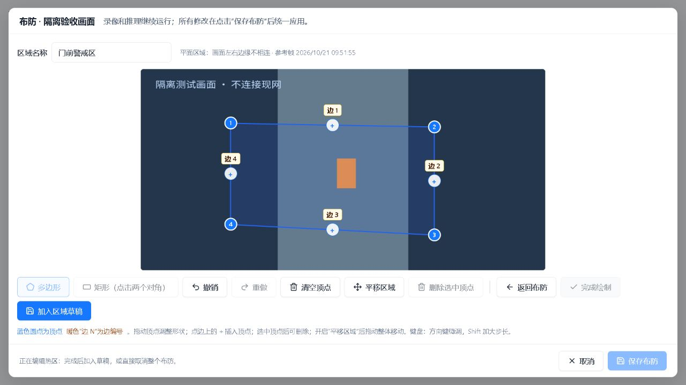
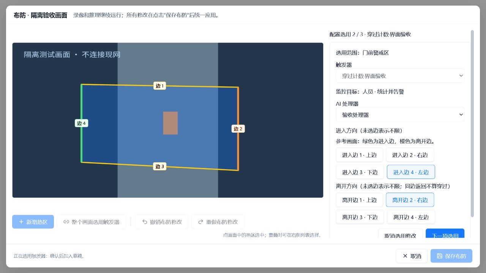
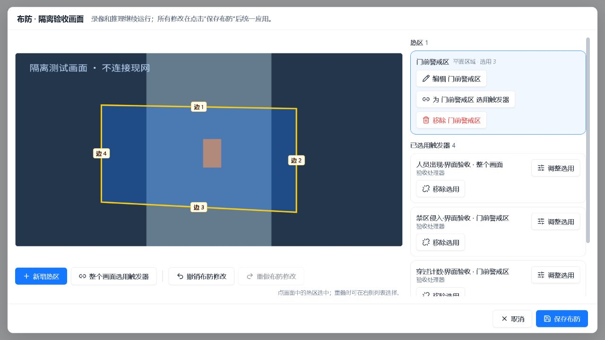
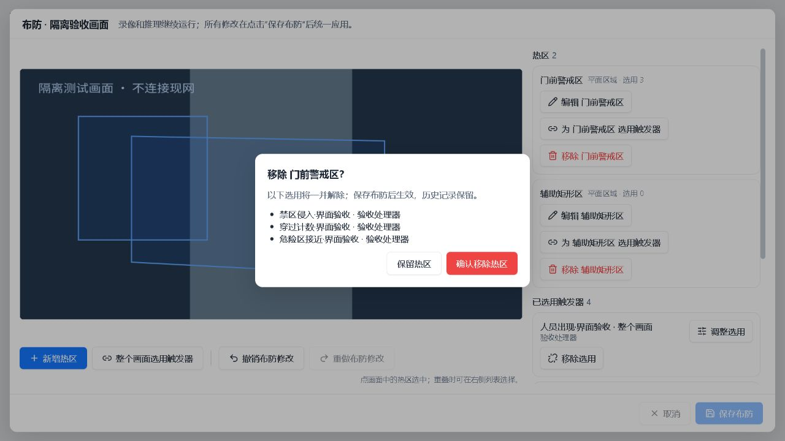
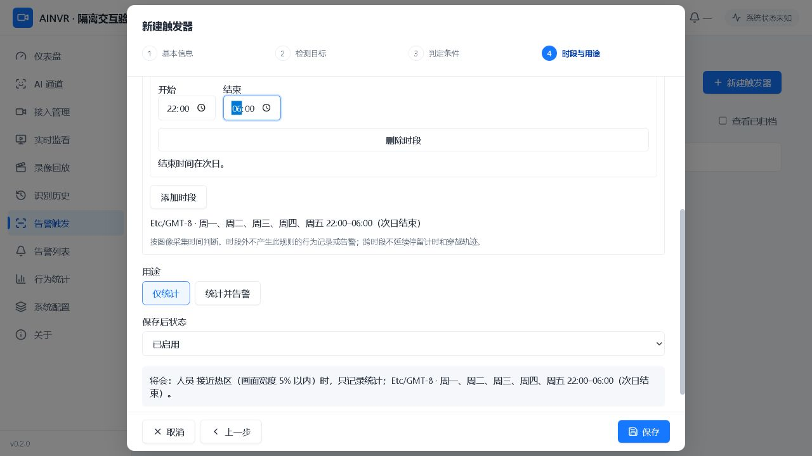

# 告警、警戒区与触发器 UI 验收（2026-10-21）

本次基于用户最新代码继续修改，保留 FitFrame 自适应画面、右侧选用列表、边中点插点和通用按钮样式。重点是普通 2D 布防。本文件将浏览器实操与自动测试分开列出，不把合成视频、隔离数据库验收称为生产硬件链路验收。

## 视觉与交互调整

- 顶点按钮仍有44×44px触摸范围，但只绘制24px蓝色圆点，选中后轻微突出。边编号用暖色“边 N”标签，与顶点纯数字区分，使用CSS像素保持不同图像分辨率下大小一致。
- 边中点的“＋”继续用于插点；边号向上偏移，靠顶部时向下偏移，不再互相遮挡。方向选择时进入边/标签绿色、离开边/标签橙色，其他边号保持暖色。
- 多边形、矩形、撤销、重做、清空、平移、删除、返回、完成、保存配16px图标，同时保留文字，避免只凭图标猜操作。
- 警戒区、触发器、告警页面复用系统btn-primary/btn-secondary/form-input；按钮14px，正文14px、辅助文字12px、弹窗标题16px。粗指针设备上按钮/输入框至少44px高；桌面维持其他系统页的紧凑尺寸。
- 删除/放弃二次确认弹窗限制Tab焦点在确认区；实际保存中不显示“上次保存未确认”的误导提示。

## 用例矩阵

| 编号 | 操作与验收点 | 验证方式 | 结果 |
|---|---|---|---|
| Z01 | 打开布防；画面、工具条、选用列表同屏 | 浏览器 | 通过 |
| Z02 | 新建多边形，至少三个点，明确完成绘制 | 浏览器 | 通过 |
| Z03 | 两点矩形自动完成 | 浏览器 | 通过 |
| Z04 | 绘图撤销、重做；撤销后仍能加点 | 浏览器＋自动测试 | 通过 |
| Z05 | 拖动顶点；方向键微调 | 浏览器 | 通过 |
| Z06 | 点击边中点＋插点；删除选中点 | 浏览器 | 通过 |
| Z07 | 禁止删到少于三个点 | 自动测试 | 通过 |
| Z08 | 清空顶点、撤销恢复完整区域 | 浏览器 | 通过 |
| Z09 | 开启平移才可整体拖动，撤销恢复 | 浏览器 | 通过 |
| Z10 | 触摸被取消或第二手指介入不污染草稿 | 自动测试 | 通过 |
| Z11 | 顶点视觉24px、触摸44px；边号不挡插点 | 截图检查 | 通过 |
| Z12 | 区域加入草稿；最终保存前不写实际布防 | 浏览器＋隔离数据库 | 通过 |
| Z13 | 重新打开，区域与四项选用完整回显 | 浏览器＋隔离数据库 | 通过 |
| Z14 | 移除区域先列出关联选用，确认后联动移除 | 浏览器 | 通过 |
| Z15 | 撤销区域删除时同时恢复关联选用 | 浏览器 | 通过 |
| Z16 | 取消整次布防，未保存矩形消失、原配置保留 | 浏览器＋隔离数据库 | 通过 |
| Z17 | 修改几何后禁止未确认方向直接保存 | 浏览器 | 通过 |
| Z18 | 确认弹窗内Tab/Shift+Tab不进入背后编辑区 | 新增回归测试 | 通过 |
| A01 | 整个画面只可选出现行为 | 浏览器 | 通过 |
| A02 | 区域可批量选多个触发器，逐项确认后整体加入 | 浏览器 | 通过 |
| A03 | 唯一兼容处理器自动选定 | 浏览器 | 通过 |
| A04 | 多个处理器须明确选择；不兼容处理器不能保存 | 自动测试 | 通过 |
| A05 | 进入边绿色、离开边橙色，与画面边号一致 | 浏览器＋截图 | 通过 |
| A06 | 热区接近距离覆盖为3%，定义仍为5% | 浏览器＋隔离数据库 | 通过 |
| A07 | 批量重复选用不得部分写入 | 自动测试 | 通过 |
| A08 | 不确定保存锁定草稿，沿用操作号重试 | 自动测试 | 通过 |
| A09 | 版本冲突、区域删除与选用更新保持原子性 | 既有数据库集成证据 | 本轮未重跑 |
| T01 | 四种行为分别新建；触发器内部不选通道 | 浏览器 | 通过 |
| T02 | 空名称和未选目标不能继续 | 浏览器 | 通过 |
| T03 | 目标多选，已选目标可单独移除 | 浏览器 | 通过 |
| T04 | 出现时长、接近宽度百分比保存及回显 | 浏览器 | 通过 |
| T05 | 星期时段22:00至次日06:00预览正确 | 浏览器 | 通过 |
| T06 | 仅统计与统计并告警区分 | 浏览器 | 通过 |
| T07 | 编辑取消确认；原名称保留 | 浏览器 | 通过 |
| T08 | 改名保存；暂停；重新启用 | 浏览器 | 通过 |
| T09 | 行为筛选只显示对应触发器 | 浏览器 | 通过 |
| T10 | 归档前说明影响，归档后解除选用且历史可查 | 浏览器＋隔离数据库 | 通过 |
| T11 | 已归档项无误编辑入口 | 浏览器 | 通过 |
| T12 | 修改已选用触发器时列出受影响位置 | 浏览器 | 通过 |
| S01 | 仪表盘/识别历史/系统配置的字体、按钮样式对照 | 生产页面只读检查 | 通过 |
| S02 | 普通二维绘图和方向选择的截图留存 | 内置浏览器 | 通过 |
| S03 | 真实iPad触屏、横竖屏和软键盘 | 实机测试 | 待用户设备验收 |
| S04 | 本次全景算法、跨缝跟踪验证 | 本期不扩展 | 未执行 |

## 截图

截图均来自内置浏览器的隔离交互环境，配置写入临时数据库，画面为合成素材。生产页面只读对照截图保留在本机任务暂存目录，没有作为产品素材提交。

### 绘图控制点、边号及工具条

### 关联方向与区域边高亮

### 区域和选用统一保存前的汇总

### 移除区域的关联影响确认

### 触发器周时段与跨午夜预览

## 复现与证据

- 本次冻结候选：`/mnt/ainvr-ssd/ainvr-alarm-refactor-web-20261021-ui-polish-r3`。
- 浏览器正常流程在ui-polish候选验证；r2增加二次确认键盘焦点修正及保存提示修正；r3为绘图提示预留高度，避免校验提示挤动画布。r3已部署前端，并在生产页面实际检查小控制点、工具图标、边编号与确认弹窗Tab闭环；生产测试草稿全部取消，未保存实际布防。
- r2全量139文件1066项通过，无失败/跳过；r3最后布局调整后26项专项回归通过；构建通过。
- 前端全量日志：`test/results/ui-polish-full-r2-20261021.log`；专项：`ui-polish-final-focused-20261021.log`。
- 8项存储/编译规则核对全部通过，见`test/results/ui-polish-browser-contract-assertions-20261021.json`。
- 保存后的真实存储/编译规则证据：`test/results/ui-polish-browser-contract-20261021.json`；归档后的证据：`ui-polish-browser-contract-final-20261021.json`。
- 生产静态资源更新记录沿用事务安装器的`test/results/alarm-submit-dashboard-deployment-20261019.json`，以其中时间、候选路径及phase为准。
- 未提交代码。真实iPad未在本机连接，不能把浏览器指针测试称为iPad实机验收。
