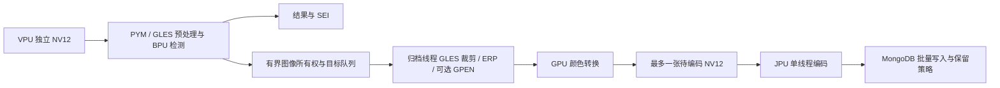

# S100P 截图归档流水线优化（2026-10-13）

适用仓库：`/home/sunrise/ainvr`。保持 HBM、检测阈值、截图质量、通道和录像配置不变；模型推理仍是 BPU，图像处理为 GLES，JPEG 为 JPU。没有增加 CPU 图像处理回退。

## 已定位的问题与改动

1. 旧生产线程每帧先把 3840×1920 NV12 转成整张 RGBA（29,491,200 字节），平均约 43.8 ms，再交给后台裁剪。现在通过 `FrameProvider.owned_download` 传递独立持有的、不可变 NV12 图像。后台归档线程执行 ROI 转换，推理线程不等待整帧 RGBA 下载。回调不捕获 Worker、推理 GLES 上下文或 SDK 解码缓冲；旧的同步下载接口仍保留。
2. 同一帧的多个目标可以在每个归档线程复用 NV12 GPU 纹理。全进程唯一非零标签标识不可变帧；未提供标签、换帧、尺寸变化、未标记调用或异常均使缓存失效。缓存不额外持有 CPU 像素。实测这一项单独没有明显 FPS 提升，不能宣称获得显著加速。
3. 没有实际亮度处理或人脸增强时，原图和处理图像素相同，复用一次 JPU 编码结果。两个归档字段及原图/处理图查看入口均保留。增强或亮度修正时仍分别编码。
4. GPU JPEG 颜色转换与 JPU 编码改为两个各自持有资源的线程。待编码队列最多一张 NV12 图像，另外转换和编码阶段各至多一张在途；JPU 仍串行运行并保持 SDK 奇数尺寸的原有上下文限制。已转换的输入 RGBA 立即释放，关闭时排空后依次回收两个线程。
5. 修正容量等待的条件变量：队列满时等待 `queue_cond_`，源图像槽位用尽时等待 `Captures().changed`。旧实现对图像释放等错通知，可能白等到 100 ms 超时。专门回归中释放到唤醒为 0.795 ms。



仍保留归档反压：下游持续慢于源流时，有界且不丢已接收目标的系统必须限制接纳速度。不能通过无限缓存或默默丢截图来制造高 FPS，也不能仅凭 BPU 利用率判断整机是否饱和。当前区域采样路径不满足现有 PYM `source_region` 接口条件，仍使用 GLES；本次未改变投影和缩放算法。

## 相同生产配置下的阶段实验

配置哈希：`0a80cfac0793462bebafe9ed1546e0698677b96bc6af7d8bc17eb63507ce7e06`。
COCO 通道、约 30 FPS 源流，截图开启、截图间隔 0、最大边 320、JPEG 质量 82。此通道为通用目标检测，不能把该结果等同于每个目标均执行 GPEN 的人脸通道。

| 阶段 | 时长 | 推理 FPS | 实际入库目标/秒 | BPU 平均 |
|---|---:|---:|---:|---:|
| 原生产版 | 60 秒 | 10.12 | 82.04 | 27.46% |
| 后台区域处理＋避免重复 JPEG | 120 秒 | 13.29 | 109.01 | 37.20% |
| 增加纹理复用 | 60 秒 | 13.27 | 111.62 | 41.31% |
| 增加 GPU/JPU 流水线 | 120 秒 | 14.69 | 121.18 | 39.96% |

实流画面会变化，阶段结果不是完全相同帧的离线基准；质量由独立硬件测试验证。最终容量唤醒修正的三分钟结果另见下方自动汇总与 `test/results/archive-pipeline-final-20261013.json`。

## 验证与复现

- 19 项 GLES 裁剪/ERP 图像测试、10 项真实 JPU/Mongo 归档测试、62 项归档业务回归通过。
- 6 项 GLES 预处理测试包含纹理缓存换帧和 ROI 切换；20 项 Worker 测试包含真实 VPU 输入跨线程逐像素相等、异步失败、停止和重启。
- 真实 GPEN HBM：36 条原图/增强图归档通过；24 条热阶段约 75.925 张/秒。代表原图和增强图 SHA-256 与此前验收版本分别完全相同。这是固定 96×96 裁剪的短测试，不是完整人脸视频的 FPS 承诺。
- 保留一次新增跨线程测试的冷启动超时失败及随后修正后的结果，不删除失败证据。另有一次新测试漏写 `<future>` 的编译失败，补齐后完整验证通过。

只读生产采样（输出文件必须不存在，不会改通道）：

```bash
cd /home/sunrise/ainvr
python3 test/ai_port/measure_archive_pipeline.py \
  --channel-id 2baec0a3-9941-47dc-b1bd-d3d284488097 \
  --seconds 180 --output test/results/archive-observation-new.json
```

采样保存二进制哈希、配置哈希、PID、真实推理/入库计数、资源、各段耗时及队列。换 PID、计数回退或配置改变会使连续性检查失败。凭据只在内存中读取，不写入报告。

硬件测试必须串行执行，并按原状态恢复 AI 与录像服务。通用验证入口为 `test/ai_port/run_hardware_archive_validation.py --build-dir out/build/ai-api-compat`；真实 GPEN 入口 `test/ai_port/run_gpen_archive_probe.py` 新增 `--build-dir` 以明确测试哪个构建产物。

部署使用 `deploy-package/install-ai-s100p.py --binary out/build/ai-api-compat/ainvr_s100p_control_service --start`，先备份旧二进制并核对配置未变。每次安装的回退目录记录在对应 `test/results/archive-*-install*.log` 中。

## 最终选择与实流结果

保留 **4 线程**。相同配置三分钟：19.5569 FPS、159.9067 个目标/秒、BPU 平均 56.1351%，峰值 RSS 1,387,776 KiB（约 1.32 GiB）。相对最初基线，推理 1.932 倍、入库 1.949 倍。队列最大 35 个未完成目标，待落盘字节始终为 0；未出现归档丢弃、隔离或故障。最后一分钟 RSS 在 1,241,344～1,368,128 KiB 间波动，没有持续增长。

6 线程候选三分钟只有 18.3100 FPS、151.5446 个目标/秒、BPU 平均 51.4324%，峰值 RSS 1,795,584 KiB（约 1.71 GiB），因此撤销。不是线程越多越快；Mali 驱动的 busy/idle 采样显示图像端高忙碌，多线程增加了该资源的争用。原始 GPU/JPU 驱动计数保存在六线程报告；不把 JPU loading 的未确认单位解读成利用率百分比。

推理线程截图 Offer 平均约 0.19 ms，主要图像工作已经移至后台。依然保留反压和每帧目标完整归档，源图像槽位上限仍是两张。运行中的 HBM 未更换，配置哈希在所有阶段完全一致。

边界：四线程三分钟窗口包含启动期，共 6 次 SEI 迟到；排除前 30 秒后仍有 2 次，发布器重连为 0。这不能描述成 SEI 零迟到，后续若要求每帧元数据严格不迟到，需要单独优化发布截止时间/帧龄合同。本次没有放宽发布缓冲参数来隐藏结果。

最终选择汇总：`test/results/archive-pipeline-selection-20261013.json`。主证据：`test/results/archive-pipeline-final-20261013.json`。额外线程失败收益证据：`test/results/archive-six-after-20261013.json`。本次只证明上述条件下显著改善，不宣称达到所有硬件的绝对极限。

恢复所选四线程版本后再次独立观察 60 秒：20.117 FPS、168.343 个目标/秒、BPU 平均 61.154%，峰值 RSS 1,347,328 KiB。Mali 驱动 busy/(busy+idle) 采样平均 84.63%（范围 83.31%～85.97%），表示该驱动统计窗口内 GPU 高忙碌，不能当作 BPU 可直接利用的余量。该次新增 SEI 迟到 6、重连 0。证据：`test/results/archive-selected-four-restored-20261013.json`。
