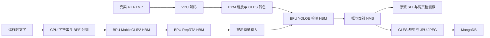

# S100P YOLOE 动态描述：部署与验证

当前工作目录 `/home/sunrise/ainvr`，板端原生服务版本 `ainvr-s100p-reused-control-0.13`。YOLO26x COCO80、YOLO26x-face、GPEN256 和 YOLOE-26x 均已完成 HBM、BPU 与前后端接线。YOLOE 的检测器、匹配的 MobileCLIP2 文字编码器和 RepRTA 分别是 HBM，板端不依赖 Torch、ONNX Runtime、CUDA 或 GPU 神经网络推理。

## 网页使用

在 AI 通道向导的“模型与推理”页选择“开放词汇”，填写识别描述、稳定标签 ID 和显示标签。例如描述 `person`、标签 ID `person`、显示名“行人”。建议使用英文短描述；模型并不保证任何词都能在任何画面中识别。默认目标 5 FPS，可结合实测调整。

输出仍选择接入管理中已有的 AI 输出通道；不得选与源流相同的流形成回环。保存后重新载入通道，文字在 BPU 上重新编码，不重新编译 HBM。网页目前是一条描述对应一个标签；原生接口有 8 个提示槽，可通过 `class_names` 承载最多 8 条文字，不能把槽数量说成固定词表。描述超过 77 个模型 token（含起止 token）时明确拒绝，不静默截断。旧 LocateAnything 等模型仅保留历史兼容，不开放新选择。

最终保留用户原配置：COCO80、目标 15 FPS、截图关闭，`live/xm` → 既有 `live/ai-n2q08c`。YOLOE 已安装，可自行选择；验收没有永久改动原通道配置。

## 实际路径



CPU 只做字符串、token/精确整数索引、字节打包、框/NMS 和业务控制；所有神经网络在 BPU。图像转换、裁剪和编码使用专用硬件或 GLES，没有 CPU 图像回退。文本编译报告中的三项 CPU 操作仅为 `token_low_index`、`token_hi_offset`、`token_high_index` 的精确 INT32 索引逻辑。

检测器输入 `images [1,3,640,640]` 与 `prompt_embeddings [1,8,512]`，输出 `boxes_scores [1,12,8400]`。FP32 输入/输出缓冲格式不表示全网络 FP32；当前 Nash 运算使用经过验证的整数/浮点混合精度。空提示槽须在 RepRTA 之后清零，其偏置会使 RepRTA(0) 不为零。本交付验证检测框，不宣称分割掩码交付。

文字只在载入或修改配置时执行，逐帧复用本次由 BPU 实际生成的向量；不是固定向量库或远程文本服务。分词辅助进程不继承服务敏感环境和工作描述符，有输入大小、token 数和 5 秒期限限制。保留 Python 虚拟环境的可执行入口路径，不能将其符号链接展开为系统 Python，否则会丢失分词包。

## 模型与存储

生产 HBM 和 CLIP MIT 分词资产位于 SSD `/mnt/ainvr-ssd/ainvr-models/yoloe-26x-20261013/`，项目 `ai-service/models/derived/s100p/` 中是 HBM 链接及契约。PT/ONNX、校准图和编译目录不进入生产模型目录。

| 文件 | SHA256 | 版本 |
| --- | --- | --- |
| `yoloe-26x.hbm` | `9085fb79005892dcf9def5ca9d9043167c32373df05bff582a7e3f9489ed2ebd` | 检测 O2 v3，与已验证 O0 同 BC、128 输出逐位相同 |
| `yoloe-26x-text.hbm` | `0bd2f438e56b77f97699385966de3e7264ac7061ab35a44b9b58d6958a5d5440` | 成功文字 v18，当前 O0，仅载入/改词时执行 |
| `yoloe-26x-reprta.hbm` | `9c83212eadae6ecfe788bd2c7bc1d3c9f72c4a0565fcf0feffb842be4189fdd9` | 匹配 RepRTA v5，当前 O0 |

旧文字 O2 v13 来自不合格组合的 v12，不能替换 v18。以后优化文字/RepRTA，继续复用各自成功 BC，先逐位复验再测速；当前逐帧检测已使用 O2，不需为达到目标继续等待辅助模型优化。

分词环境是 SSD `yoloe-tokenizer-venv-20261013`，`ftfy==6.3.1`、`regex==2026.9.29`，无 Torch。OpenAI CLIP 原始 MIT 文件和许可、来源哈希已保留；Ultralytics 研究参考的 AGPL 许可另行保留，没有改为 AINVR 署名。安装脚本 `deploy-package/install-yoloe-s100p.py` 校验现有完整质量结果，安装 SSD 组件和链接，不重启服务。原生二进制仍由 `deploy-package/install-ai-s100p.py` 事务安装并保留回滚。

## 验收证据与限制

- `test/results/yoloe-final-unseen-parity-20261013.json`：在推理前确定的新 128 图，覆盖 80 类，与旧 640 图文件和 SHA 不重叠；完整 BPU 文本链路对原始 FP32 的 P/R/IoU 为 0.959528/0.951505/0.980507。这是结果一致性，不是官方 COCO AP。
- `yoloe-free-text-visible-20261013.json`：四个预定自由描述案例的全部生产 NMS 框，无相对 FP32 多检/漏检；两个匹配框 IoU 0.9898/0.9948。公交车/行人描述改为飞机/叉车，同一 HBM 输出改变。原始模型对狗图的 domestic-animal 描述漏检保留，不通过降低 0.25 阈值冒充成功。
- `yoloe-free-text-semantic-final-20261013.json`：原逐网格最大概率误差检查仍失败（0.394 > 0.15）。后续最终框测试是另一项产品输出检查，没有把原失败改成成功，也没有仅取最高框。128 图报告亦保留 raw 差异；未证明逐网格等价。
- `yoloe-channel-contract-20261013.json`：实际配置解析与组件契约 10 案例通过，包括超槽/超 token、错误组件 SHA、独立图不足和质量未批准的拒绝。
- `yoloe-channel-adapter-live-20261013.json`：真实 3840×1920，原生适配器两组文字、12 帧，`pym+gles-color`；首帧图像初始化约 1.4 秒，温热适配器约 22 FPS，包含预处理和 NMS，仍不是 RTMP 全链路帧率。
- `yoloe-live-person-service-20261013.json`、`yoloe-live-airplane-service-20261013.json`：正常网页保存及运行时改词；实际生产通道约 6.5–8.8 FPS（目标 10，归档关闭），同一检测 HBM SHA。后续修正了 raw 模型 `end2end=false` 元数据。
- `yoloe-actual-sei-output-20261013.json`：实际检测经原 SEI 发布器和 SRS，回读 3 帧真实行人标签，不注入伪测试检测。
- `yoloe-production-worker-archive-v3-20261013.json`：真正生产 ReusedChannelWorker/SnapshotStore、独立历史集合，20 条记录的模型/文字/标签/JPEG 查询验证；accepted=committed=20，outstanding=quarantined=0，JPU=40，CPU JPEG=0。失败 v1 数据库范围、v2 关闭连接后查询的探针错误和日志均保留；未改变用户历史。
- 前端 99 个相关测试通过、生产构建通过；原生 43 项回归和最终 Worker 19 项复验通过。GPEN 的严格数值失败和用户视觉验收例外见主 readiness 文档，不能推广为其他模型的豁免。

## 复现入口

探针代码在 `test/ai_port/`，Python 转换/比较脚本在 `test/model_conversion/`，大样本和失败产物保留 SSD。在现有配置基础上构建：

```sh
cd /home/sunrise/ainvr
cmake -S ai-service -B out/build/ai-api-compat
cmake --build out/build/ai-api-compat --parallel 2 --target \
  ainvr_yoloe_channel_adapter_probe ainvr_yoloe_reused_archive_probe \
  ainvr_read_yoloe_live_sei ainvr_yoloe_decode_probe \
  ainvr_yoloe_prompt_probe ainvr_yoloe_text_probe ainvr_yoloe_tensor_probe
```

这些需要明确 CLI 参数的探针不自动作为 ctest 运行，不能因执行帮助或空参数就当硬件测试通过。归档探针读取私有 Mongo URI 环境变量，只能使用已授权数据库中的独立测试集合；不能将凭据放在命令行、脚本或日志。不得停止矿工或据历史静默 PID 重启编译。
