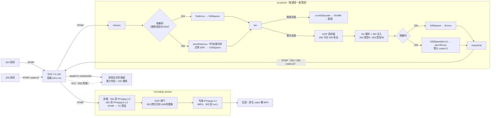

# H.265（RTMP codec12）全链路支持设计

| 项 | 内容 |
|---|---|
| 版本 | v2.2（2026-09-29；v2 整体修订取代 v1；v2.1 落实 §13 两项决策；v2.2 按实现与实测结果整体校订，见下方"v2.2 变化"与 §14） |
| 状态 | **开发完成，待现场验收**：代码已在开发母版板（192.168.100.183）部署运行；真实 H.265 相机、iPad、长稳、回滚等验收项见 §14 |
| 范围 | SRS、ai-service、recording-service、控制台前后端（监看/通道/AI/录像回放/系统配置）、发布包与授权 |
| 目标 | 接入 **RTMP codec12 H.265 摄像头**，流程与现有 H.264 一致：相机 RTMP 推 → SRS → 浏览器 WebRTC 看；AI 服务 RTMP 拉、推回 **codec12** AI 流；录像 RTMP 拉、存 MP4 |
| 硬约束 | 任何 H.264 通道行为不变（唯一例外：非 Chrome 浏览器由"不画识别框"变为"近似对齐画框"，按用户决策，§8.2）；不升级 JetPack/GStreamer；H.265 只重封装、不转码；授权执行器架构不变 |
| 证据 | 标"实测"的结论均在板上复现过（实验环境 `/home/sunrise/h265lab/` 或部署后的生产实例）；标"待验证/未实测"的没有 |

v1 → v2：AI 路线收敛为自研 GStreamer FLV-HEVC 元件；AI 输出默认 codec12；"流变化统一模型"（§5）；AI 丢帧恢复点、
录像切段点改为 **IDR** 且跨 TS 包识别；补齐发布包、授权、回滚闭环（§9）。v2.1：录像直接用 SRS 镜像自带的
FFmpeg 8.1.2（许可已获得）；叠框统一为"逐帧 / 近似 / 不可用"三种模式。

v2.2 变化（按实现与实测校订，不是新设计）：
- H.265 的浏览器兜底由"HTTP-FLV + mpegts.js"改为 **HLS + hls.js**：mpegts.js 依赖 git 源，被项目 npm 安全配置
  `allow-git=none` 拒绝；项目已有的 hls.js 1.7.2 自带 HEVC-in-TS 解析（F15）。
- 更正现状描述：非 Chrome 浏览器此前**不画识别框**（墙钟推算路径早已删除），不是"按墙钟画框"。
- 近似对齐的精度改为"算法无累加项，真机误差待测"——单测只证明模型自洽（§8.2）。
- 解封装在丢坏帧/重同步/开流时**等下一个 IDR 再放行**，等待超过 10 s 明确报错（§6.2）；FLV 头偏移严格校验。
- FFmpeg 8.1.2 的安装归**录像组件**（完整安装与 `--only python` 行为一致，§9.2）。
- 播放能力按**码流实际档位**判定（SRS 报 `level`，F13），不再一律按 4K 探测。
- 开发母版板上 SRS 已提前切换到 7.0.162（用户确认该板是开发母版的测试环境，§10）。

---

## 1. 决策

| # | 决策 | 理由 |
|---|---|---|
| D1 | SRS 升级到 **`ossrs/srs:7.0.162`**（镜像 ID `sha256:b2e0b417…b9028`，安装后校验）；容器名保持 `ainvr-srs` | rtmp→WebRTC HEVC 从 7.0.33 才有（v6 全系没有）；7.0.162 含 HEVC 协商修复 #4742。v7 目前只有 alpha，靠长稳验收与 §9.4 回滚兜底 |
| D2 | **ai-service 用自研 GStreamer 元件**处理 FLV-HEVC（`ainvrflvdemux` / `ainvrflvmux`），不引入外部进程 | 实测 GStreamer 1.20 的 RTMP 收发与编码无关，缺的只是 FLV 里 HEVC 的编解封装；与 264 管线同构 |
| D3 | **AI 输出默认 codec12**，Enhanced（`hvc1`）为可选 | 项目标准是 codec12；外部设备可能只认 codec12。SRS 原样透传 FLV 封装（F2） |
| D4 | **录像 265 通道读端使用 SRS 镜像自带的 FFmpeg 8.1.2**（sha256 `df17651e…a9da8`），仅做 RTMP/FLV 解封装 → TS，与系统 FFmpeg 4.4 并存 | 4.4 读不了 FLV HEVC；该二进制即实测所用；含 gpl/nonfree 组件，**相关许可已获得（2026-09-29 用户确认）** |
| D5 | 265 **只在 IDR 处**切录像文件、恢复发送、恢复解码 | CRA/开放 GOP 后的 RASL 帧依赖前一 GOP；`h265parse`、FFmpeg 都会把 CRA 当关键帧 |
| D6 | 录像保存格式不变：**fMP4（.mp4）**，265 写 `hvc1` 标记 | 浏览器原生播放 + HTTP Range；Safari/iPad 需要 `hvc1` |
| D7 | 编码**不是用户配置项**，由各服务从 SRS `/api/v1/streams` 的 `video.codec`（实测 265 为 `HEVC`）和码流本身识别 | 相机决定编码；配置只会出错 |
| D8 | 不做服务端 265→264 转码；浏览器播不了时明确提示原因 | 转码占用 NVENC、增加延迟 |
| D9 | 叠框三种模式：**逐帧**（按 RTP 时间戳精确绑定）、**近似**（每帧按实测延迟重新对齐，无累加项，允许 1–2 帧偏差）、**不可用**（明确提示）。264 与 265 同一套逻辑 | 用户决策：非 Chrome 浏览器差一两帧可接受，但不能累计误差 |
| D10 | 浏览器播不了 H.265 WebRTC 时以 **HLS 兜底**（优先 hls.js，原生 HLS 最后手段），无识别框并在画面上说明原因 | mpegts.js 被 npm 安全配置拒绝；hls.js 已在项目内且能解 TS 内 HEVC（F15）；Apple 原生 HLS 规范要求 HEVC 用 fMP4，SRS 输出 TS |

---

## 2. 首版兼容范围（265 通道准入条件）

首版只保证下面范围内的 H.265 源。超出范围**运行时检测、明确报出原因**，不静默降级或花屏。

| 项 | 要求 | 运行时检测方 | 不满足时（已实现） |
|---|---|---|---|
| 封装 | RTMP，FLV 视频 tag 为 codec12（`CodecID=12`）或 Enhanced（ExHeader+`hvc1`） | ainvrflvdemux | 通道 error，`last_error`"不支持的 FLV 视频封装" |
| Profile | HEVC Main（8 bit，4:2:0） | ainvrflvdemux 解析实际 SPS；hvcC 头字段不一致时按 SPS 修正 | 通道 error（"H.265 序列头无效"） |
| B 帧 | 无（CTS 恒 0） | ainvrflvdemux | 告警一次；stats `source_bframes=true`；通道卡片/通道详情提示"建议关闭 B 帧"；不中断 AI/录像（封装写真实 CTS） |
| GOP | 周期 IDR（NAL 19/20），间隔 ≤ 2 s；不依赖 CRA | AI 解封装、AI 丢帧器、录像闸门 | AI：等待 IDR 超过 10 s → 通道 error（"没有 IDR 关键帧…请改为闭合 GOP"），由重连状态机重试；录像：超过 10 s 无 IDR → `codecWarning=no_idr` 且不开新文件；开放 GOP → `open_gop` 告警 |
| 参数集 | 每个 IDR 前带 VPS/SPS/PPS | 录像闸门 | 参数集变化后第一个 IDR 处强制切新文件 |
| 音频 | 无，或 AAC-LC | 录像/SRS | 其他音频编码：录像只录视频（**AAC 与 265 的组合未实测**，§14） |
| 分辨率 | ≤ 3840×2160 | ai-service | 超出：error |

---

## 3. 实测事实

| # | 事实 | 设计依赖 |
|---|---|---|
| F1 | SRS 7.0.162 收 codec12（日志 `vcodec=12`）与 Enhanced（`vcodec=1752589105`），均识别为 HEVC Main。codec12 源为自造通行写法，**真实相机待验证** | D1 |
| F2 | SRS 转发 RTMP/HTTP-FLV **原样透传 FLV 封装**：codec12 进→codec12 出，Enhanced 进→Enhanced 出 | D3，验收方法 |
| F3 | SRS 生成的 TS 是标准 HEVC、SEI 全保留，但关键帧**不置** random_access_indicator | §7 |
| F4 | FFmpeg 4.4 读不了任何 FLV HEVC；8.1.2 两种都能读，推 HEVC 只写 Enhanced | D3、D4 |
| F5 | GStreamer 1.20：`rtmpsrc`/`rtmp2src` 原样透传两种 HEVC tag；`rtmp2sink` 按"一个 tag 一个 buffer"发送，**带 HEADER 标志的 buffer 会被跳过**；`flvdemux`/`flvmux` 不认 HEVC | D2 |
| F6 | WebRTC H.265：codec12/Enhanced/AI 回推等源，SRS 应答均为 `H265/90000`；编码帧为 Annex-B，SEI 100% 可见 | §8 |
| F7 | 叠框对齐（Chromium）：剔除测量竞态后 95% 同帧，约 2% 画面晚 1–2 帧，原因未定；**Safari 未测** | §8.2 |
| F8 | 录像组合：FFmpeg 8.1 读端 codec12→TS → FFmpeg 4.4 写端 fMP4 `hvc1`：全帧解码无错，SEI 区间可扫出 | D4、D6 |
| F9 | 264 回归：生产 4K/B 帧/AAC 流在 v6、v7 上表现一致，264 AI 输出 SEI 在 v7 可见 | D1 |
| F10 | SRS 7.0.162 直接接受生产 `srs.conf` 的 v6 写法启动；生产切换时沿用原配置，264 源与 AI 输出 5 s 内自动重连 | §9.4 |
| F11 | SRS 6.0.191 与 7.0.162 镜像自带同一个 FFmpeg 8.1.2（sha256 `df17651e…a9da8`） | D4、§9.2 |
| F12 | SRT 只能拉 SRT 推入的流；`http_remux` 一个 vhost 只能挂一种格式；flv.js 不支持 HEVC；mpegts.js 支持但被 npm `allow-git=none` 拒装 | §12、D10 |
| F13 | SRS `/api/v1/streams` 的 `video` 字段：H.264 `{codec:"H264",profile:"High",level:"5.1",width,height}`，H.265 `{codec:"HEVC",profile:"Main",level:"3.1",…}`——**level 是字符串** | §8.2 |
| F14 | SRS 为 H.265 AI 输出生成 HLS：MPEG-TS 分片（stream type 0x24），每 10 s 分片内 SEI 99 条 | D10 |
| F15 | 前端 hls.js 1.7.2 内含 `HevcVideoParser`（TS stream type 0x24），可把 TS 内 HEVC 转封装为 fMP4 交给 MSE/ManagedMediaSource | D10 |
| F16 | 同源、同分辨率（1280×640@15）、同模型、同负载对照：H.264 输入推理 9.1–9.5 fps（48–52 ms/帧），H.265 输入 8.9–9.0 fps（57–60 ms/帧），两路并行时 GPU 推理是瓶颈；差值与测试推流器软件 x265 占 4.7 核同步出现（生产 264 通道同期同样下降），**不是 H.265 解码造成** | §6、§14 |
| F17 | Chrome（有硬解）上 H.265 AI 输出经 WebRTC 播放、逐帧识别框正确贴合（用户实机截图） | §8 |

---

## 4. 目标架构



- 264 与 265 在 AI 里**只在解封装、封装两处分叉**，丢帧器、AU 缓存、推理、快照、发布重连共用。
- 录像只在读端二进制和闸门的 HEVC 解析处分叉。
- 实验用的 FFmpeg 子进程桥接（`ai_rtmp_sim.sh`）**不进生产**。

---

## 5. 编码识别与流变化统一模型

### 5.1 事件定义

| 事件 | 触发 | 识别方式 |
|---|---|---|
| E1 源重新发布 | 相机断线重连、SRS 重启 | RTMP 连接断开/EOF |
| E2 编码变化 | 相机从 264 改 265（或反之） | 重连后 SRS `video.codec` 不同；或 FLV 序列头的 CodecID/FourCC 与当前不同 |
| E3 同编码参数变化 | 分辨率、profile、帧率改变 | 新的 FLV 序列头（hvcC 内容变化）；录像侧为 TS 内 VPS/SPS/PPS 字节变化 |
| E4 AI 输出重连 | SRS 断开 AI 推流、发布 EOS | 发布管线 EOS/错误（现有机制） |

### 5.2 各服务的处理（均已实现）

| 服务 | E1 | E2 | E3 | E4 |
|---|---|---|---|---|
| ai-service 拉流 | 现有重连状态机；解封装重新进入"等 IDR" | 每次（重）建管线前问 SRS 编码并选 demux 分支；另从码流首个视频 tag 认编码，与管线不符立即报错重建，重建以码流认出的编码为准（源未上线时建的管线、SRS 滞后都由此纠正） | ainvrflvdemux 发现序列头内容变化即报错（"源参数变化"），重连状态机重建整条管线。不做管线内重新协商（零拷贝链路中途变分辨率未验证） | — |
| ai-service 发布 | 清空 AU 缓存、`PtsRebaser::Reset()`、丢帧器等 IDR；元件重发 FLV 头+onMetaData+序列头 | 发布支路发现源编码与发布管线不一致 → 触发发布管线整体重建（实测 265→264→265 自动恢复） | 随拉流重建 | 现有重连 |
| 录像 | 读端 EOF → 闸门收尾当前文件 → 监督器按退避重启 | 源已上线但编码未知时**先等识别**（最多 15 s，超时按默认读端兜底并告警），不按 264 猜着拉起；读端二进制不对（如 4.4 读 265）→ 立即停掉旧管线、不走退避按新编码重启；兜底后得知是 264：读端本来就对，只补记编码、不重启 | 闸门在参数集变化后的第一个 IDR 处强制切新文件 | — |
| 前端实时 | WebRTC 断流 → 现有重连 | 通道状态里的编码变化 → 播放方式重新判定并重建连接 | 浏览器解码器自适应；叠框坐标按实际宽高换算 | — |
| 前端 SEI 缓存 | 每次（重）建连清空 SEI 缓存、到达时间线与延迟估计 | 同左 | 不清 | — |
| 回放 | 按文件粒度 | 播放器按每个分段的 `codec` 与宽高判定能否播放 | 每个文件自包含参数 | — |

### 5.3 验收

已实测：AI 通道 265→264→265 同流名切换自动恢复，AI 输出为 codec12；录像 codec12 分段全帧解码无错。
待测：改分辨率重推（E3）、推流中途换参数集、浏览器在编码变化后 10 s 内恢复画面（§14）。

---

## 6. ai-service 设计

### 6.1 拉流分支

```
264（不变）：rtmpsrc ! flvdemux ! queue ! h264parse config-interval=-1 ! tee
265：        rtmpsrc ! ainvrflvdemux ! queue ! h265parse config-interval=-1
                   ! video/x-h265,stream-format=byte-stream,alignment=au ! tee
tee 之后两者相同：推理支路 nvv4l2decoder → NVMM RGBA → appsink；发布支路 queue(q_pub) → appsink
```

- 编码在建管线前确定：`srs_codec_probe` 查 SRS `/api/v1/streams`（超时 1 s，源在外部 SRS 时按源地址推断 API 地址），每次重连都重新查询（覆盖 E2）；拿不到时沿用上次（初始 H.264）。
- **码流为准**：三种拉流管线都在拉流元件输出挂编码探针（`flv::VideoCodecSniffer`，看首个视频 tag 的 CodecID 7/12 或 Enhanced FourCC avc1/hvc1）。相符 → 探针自行移除，此后零开销；不符 → 丢弃数据、记下实际编码并报错，重连时以它为准重建（优先于 SRS 查询）；1 MiB 内无可识别视频 tag 或首个视频 tag 为其他编码 → 放弃探测，不猜。实测：源未上线时创建通道（先按 H.264 建管线），随后推 H.265，5 s 内按 H.265 出帧，日志"源实际编码为 h265…按实际编码重建"。
- 仅供调试的 `stream.codec_override`（配置文件项，不上 UI，默认不设）。
- 两个元件在进程内静态注册（`RegisterAINVRFlvElements()`），不单独部署 `.so`。

### 6.2 `ainvrflvdemux` 规格

输入 `video/x-flv` 字节流（tag 可能跨 buffer、一个 buffer 可能含多个 tag）。输出一个视频 src pad：
`video/x-h265, stream-format=hvc1, alignment=au, codec_data=<hvcC>`。音频 tag 丢弃。纯 C++ 解析在 `flv_hevc.cpp`（`TagReader`），元件是其外壳。

| 要求 | 规则 |
|---|---|
| FLV 头 | `DataOffset` 须在 9..1024；**头（含扩展字节）+ PreviousTagSize0 收齐之前不移动游标**；非法偏移按损坏处理，计一次重同步后逐字节找回合法 tag（此前按声明值移动游标会越界读，已由 ASan 复现并修复） |
| 拆包/粘包 | 按 11 字节 tag 头 + DataSize + 4 字节 PreviousTagSize 切分；任意切分边界 |
| 损坏/重同步 | 单 tag ≤ 16 MiB；类型、stream id、PreviousTagSize 不自洽即逐字节向前重同步并计数；单次重同步跳过 > 1 MiB → 报错 |
| 两种写法 | codec12：`b0&0x0F==12`，`b1` 为 AVCPacketType，`b2..b4` 为有符号 24 位 CTS；Enhanced：`b0&0x80`，PacketType 0/1/3/2，`b1..b4` 须为 `hvc1` |
| hvcC 校验 | configurationVersion==1、lengthSize 1/2/4、数组不越界、VPS/SPS/PPS 各至少一个、实际 SPS 为 Main / 8 bit / 4:2:0；按 SPS 规范化 hvcC 的 PTL、色度、位深与时间层字段；参数集 NAL 保持原样 |
| 帧数据校验 | 按 lengthSize 逐个 NAL 检查长度；越界帧丢弃计数；连续 50 个坏帧 → 报错 |
| **等 IDR** | 开流、丢了坏帧、发生 tag 重同步之后，参考链可能已断：**后续非 IDR 帧一律丢弃，直到下一个 IDR**；恢复点 IDR 标 `DISCONT`。等待期间按 DTS 超过 10 s 仍无 IDR → 报错（开放 GOP/只有 CRA 的相机在这里明确暴露），交给重连状态机 |
| 时间戳 | 32 位扩展时间戳；DTS = 时间戳，PTS = DTS + CTS；回退 >1 s 或跳变 >10 s 置 DISCONT |
| 关键帧标志 | FrameType 仅作提示；是否 IDR 以 NAL 类型为准（19/20 → 非 DELTA_UNIT） |
| 序列头 | 首个序列头决定 caps；相同的重复序列头忽略；**内容变化 → 报错（"源参数变化"）** |
| B 帧检测 | CTS≠0 时告警一次；属性 `b-frames=true` |
| 事件 | `FLUSH_STOP` 后清内部状态，重新等 IDR |
| 属性（→ 通道 stats） | `format`（codec12/enhanced）、`dropped-frames`（损坏、序列头之前、等 IDR 期间丢弃的帧）、`resyncs`、`b-frames` |

### 6.3 `ainvrflvmux` 规格

输入 `video/x-h265, stream-format=hvc1, alignment=au`。输出 `video/x-flv`，**每个 FLV tag 一个 buffer，不设 HEADER 标志**（F5）。

| 要求 | 规则 |
|---|---|
| 写法 | 属性 `format=codec12|enhanced`，**默认 codec12** |
| 起始 | FLV 头、onMetaData、序列头；**第一个 IDR 之前不输出任何帧** |
| 时间戳 | tag 时间戳 = DTS；CTS 写真实值 `PTS−DTS` |
| 参数变化/重连 | 由管线重建处理（§5.2），重建即重新输出起始序列 |

### 6.4 GOP 丢帧器与恢复点

发布支路 `q_pub` 探针里的 `GopAwareShedder` 不变；265 分支在 AU 内扫描 NAL 类型，只把含 19/20 的 AU 作为恢复点（`IsShedResumePoint`），CRA 不恢复。AU 缓存的"丢帧后重新对齐"同样只在 IDR 切。

### 6.5 AU 缓存与 SEI

| | H.264 | H.265 |
|---|---|---|
| NAL 头 | 1 字节，类型 `b0 & 0x1F` | 2 字节，类型 `(b0 >> 1) & 0x3F` |
| SEI | 6，头 `06` | 前缀 SEI 39，头 `4E 01` |
| VCL | 1..5 | 0..31 |
| 恢复/切段点 | 5（IDR） | 19/20（IDR） |
| 参数集 | 7/8 | 32/33/34 |

- SEI 插在参数集之后、第一个 VCL 之前；信封、UUID、预算不变；前端与录像的 SEI 解析不用改（按 UUID 扫）。
- 编码相关规则集中在 `video_codec.hpp`；`sei.cpp` 的构造/解析/注入按编码参数化。

### 6.6 接口与状态

- 通道 stats：`video_codec`（h264/h265）；仅 265：`source_flv_format`、`demux_dropped_frames`、`demux_resyncs`、`source_bframes`；`publish.codec`、`publish.flv_format`。
- `/health`：`capabilities: {codecs: ["h264","h265"], publish_formats: ["codec12","enhanced"]}`；没有该字段 = 旧版，只支持 264（前端据此提示，§8.4③）。
- 通道配置：`publish.flv_format: codec12|enhanced`（默认 codec12；非法值拒绝）。

### 6.7 测试（已实现）

- 解析单测：任意字节切分、粘包、截断、超长 DataSize、扩展 FLV 头分批到达、非法头偏移、hvcC 损坏、NAL 越界、有符号 CTS、封装逐字节还原夹具。
- 元件单测（GstHarness）：caps/时间戳/IDR 标志、Enhanced 与 codec12 输出一致、非 HEVC 报错、序列头重复忽略/变化报错、B 帧告警、坏帧后等 IDR、重同步后等 IDR、开流在 GOP 中间、10 s 无 IDR 报错、持续垃圾输入只报错不崩、封装默认 codec12、往返等价。
- 夹具：`tests/unit/fixtures/hevc_codec12.flv`、`hevc_enhanced.flv`（`gen_flv_hevc_fixtures.py` 生成）。
- 集成（实测）：265 通道 running、demux 丢帧 0、AI 输出实际 FLV tag 为 codec12（`0x1c`）、SEI 注入正常。
- 未做：随机位翻转的模糊测试（目前只有确定性的垃圾输入/截断用例）。

---

## 7. 录像设计

### 7.1 管线（结构不变）

```
读端 FFmpeg：RTMP → -c copy -f mpegts pipe:1
  → GOP 闸门（ts_gate.py）
  → 每个文件一个写端 FFmpeg 4.4：-c copy [-tag:v hvc1] -f mp4 -movflags frag_keyframe+empty_moov+default_base_moof
```

| 位置 | 264 | 265 |
|---|---|---|
| 读端二进制 | 系统 FFmpeg 4.4 | FFmpeg 8.1.2（环境变量 `RECORDER_FFMPEG8`，默认 `/opt/ainvr/ffmpeg-8.1.2/bin/ffmpeg`） |
| 写端 | 不变 | 追加 `-tag:v hvc1`（按闸门从 TS 实际识别出的编码决定） |
| 编码选择 | 监督器启动读端时按通道当前编码选择；源在线但编码未知时先等识别（`CODEC_WAIT_SEC`=15 s，详情"源已上线，正在识别视频编码"），超时按默认读端兜底；编码变化规则见 §5.2 | 同左；缺 8.1.2 → 状态 `codec_error`，详情给出补装命令，不启动 |

### 7.2 GOP 闸门的 HEVC 解析

1. **跨包增量解析**：视频 PES 开始时建立 AU 扫描缓冲，按起始码提取 NAL 头（处理跨包拆开的起始码），直到第一个 VCL；上限 64 KiB，超限记"未知"、不作切段点。
2. **切段/恢复点 = AU 内含 NAL 19/20**；含 21（CRA）的 AU 计入 `open_gop`。
3. **参数集跟踪**：变化后在第一个 IDR 处强制切新文件（E3）。
4. **无 IDR 保护**：超过 10 s 无 IDR → `codecWarning=no_idr`，不开新文件。
5. 闸门的上限、滞回、按 GOP 丢弃逻辑不变。
6. 读端 EOF 时 `flush()` 收尾最后一个 AU。

### 7.3 其余

- `sei_worker.py`、`scanner.py`、索引已支持 hevc（实测）。
- 录像状态接口新增：`codec`、`noIdrSec`、`openGopAus`、`codecWarning`（`no_idr`/`open_gop`）；状态 `codec_error`。

---

## 8. 控制台前后端

### 8.1 公共基础

| 项 | 实现 |
|---|---|
| 编码判定 | `utils/codec.ts`：`isH265`（认 `HEVC`/`H265`/`h.265`）、`formatCodec`（显示 `H.264`/`H.265`）；修掉 `ChannelDetail` 的 `includes('h265')` 永远判不中 |
| 状态透传 | 后端通道状态透出 `videoCodec`、`videoLevel`、`videoWidth`、`videoHeight`（`/api/ai/streams` 同）；**前端映射层此前把 `videoCodec` 丢了（通道详情"视频编码"一直是 `-`），已修** |
| 本机能力 | `getCodecSupport()`：WebRTC 能否收 H265；hls.js(MSE/ManagedMediaSource)、原生 HLS、原生 MP4 文件三条路各自能播的**最高 HEVC 档位**（按 L3.1/4/4.1/5/5.1/5.2/6 逐档探测）；取编码帧接口（Chrome `createEncodedStreams` / 标准 `RTCRtpScriptTransform`）；rVFC |
| 服务端能力 | 后端 `/summary` 按 SRS **实时版本**下发 `srsVersion`、`srsVersionLive`、`srsRtcHevc`（≥7.0.33）；前端 `useServerRtcHevc` 只在 H.265 时请求（同页共用，60 s 缓存）；查询失败或 `srsVersionLive=false`（BFF 正常但 SRS 实时版本不可达）记为 `unknown`（≠ 不支持），按 3/10/30 s 退避重试，拿到结论后每 60 s 复查，结论变化时播放方式随之重判 |
| 播放库 | 不引入新库：WebRTC 为主，H.265 兜底用已有的 hls.js 1.7.2（D10） |

### 8.2 播放能力与叠框模式

**能否播放（只对 265 判定；264 行为不变）** —— `planLivePlayback(编码, 本机能力, 服务端能力, 通道协议, 码流档位)`：

| 顺序 | 条件 | 结果 |
|---|---|---|
| 0 | 服务端能力还没取到 | "正在检测 H.265 播放能力"，不建连接 |
| 0' | 服务端能力查询失败（`unknown`） | 按"暂不支持 WebRTC"继续往下判定（通常 HLS），原因写"暂时无法确认、正在重试"；重试拿到 `true` 后自动切回 WebRTC |
| 1 | 通道有 WebRTC + 服务端 ≥7.0.33 + 本机 WebRTC 能收 H265 | WebRTC |
| 2 | 通道有 HLS + hls.js 能播该档位 | HLS（hls.js），画面上说明原因 |
| 3 | 通道有 HLS + 原生 HLS 能播该档位 | HLS（原生，最后手段；TS 内 HEVC 能否原生播放**未实测**） |
| 4 | 都不行 | 不连接，明确提示原因（如"此设备的 H.265 解码最高到 L4.1，本路码流为 L5.1"） |

档位取 SRS 报的 `level`（F13），没有时按分辨率推最低档，都没有时只要求最低档、由实际播放报错兜底。

**叠框模式（WebRTC 播放时）**

| 模式 | 前提（运行时判定） | 绑定方式 | 误差 |
|---|---|---|---|
| 逐帧 | 能取 SEI **且** rVFC 给出数值型 `metadata.rtpTimestamp` | 编码帧 RTP 时间戳 → SEI 缓存 → rVFC 的 `rtpTimestamp` | Chromium 实测 95% 同帧（F7）；Chrome 上 265 实机正确（F17） |
| 近似 | 能取 SEI，但 rVFC 不给 `rtpTimestamp`，或没有 rVFC | 见下方算法 | 算法无累加项；**真机误差未测** |
| 不可用 | 取不到 SEI | 不画框，提示"当前设备不支持识别框叠加" | — |

取 SEI 的两条路：Chrome 用 `createEncodedStreams`（主线程，与改造前完全相同）；只有标准 `RTCRtpScriptTransform` 时（Safari/iPad），在 Blob Worker 里扫 UUID，只把 SEI 片段、RTP 时间戳（优先 `getMetadata().rtpTimestamp`）和到达时刻（epoch 毫秒，主线程换回 `performance.now` 时基）发回主线程。建连失败时关闭 PeerConnection 与 Worker，不留泄漏。

**近似对齐算法**

1. 每个编码帧到达时记录（到达时刻，该帧 SEI）到有界时间线（300 帧）。
2. 播放器看门狗每 2 s 取一次 `getStats`，用**两次采样的增量**估计"到达 → 显示"延迟：
   `D = Δ(jitterBufferDelay)/Δ(jitterBufferEmittedCount) + Δ(totalDecodeTime)/Δ(framesDecoded)`；计数器回退（重连）或窗口内无帧时沿用上次估计。
3. 每次画面刷新（rVFC 的 `expectedDisplayTime`，或无 rVFC 时 `requestAnimationFrame`）取“到达时刻 + D”不晚于显示时刻的最近检测结果；最多保留 300 ms，不取未来结果，超过期限则清框。
4. 每帧都用最新的 D，没有累加项，延迟涨落在一个采样窗口内被吸收。
5. 建连/重连时清空时间线并重估 D；D 未得到前不画框。

**低推理帧率下的实时显示连续性**：无 SEI 的视频帧不等于“已推理且没有目标”。逐帧路径按 90 kHz RTP 时间戳（含 32 位回绕）查询当前帧及此前最多 300 ms 的有效结果，能利用浏览器未呈现帧上的检测信息，但绝不引用未来帧。明确的空检测结果立即清框；没有空结果时以 300 ms 为最终期限。短时复用的框以 65% 不透明度显示，不代表跟踪或重新识别。此规则仅用于实时播放器，不改变录像索引或 MongoDB 归档。

显示时间和单调计时双重限制保留期限：视频停止回调后也会清框；换通道、关叠框、重建连接均清理旧状态。服务端为已完成的零目标推理注入带原始 PTS 的 `det:[]` SEI，显示到该结果时清框；有目标但预算不足而省略载荷时不发送假空结果。未被推理的帧仍不注入结果。录像的“存在识别目标”索引只统计非空 det，不把空结果计成目标。

诊断：需要排障时以 `?overlayDiagnostics=1` 打开实时页面（已有查询参数则追加 `&overlayDiagnostics=1`）。浏览器每 15 秒输出一条 `[sei-overlay]` 汇总，同步放在 canvas 的 `data-overlay-stats` 中；默认不输出。包括编码帧收到数、成功解析数、含目标结果数、异常载荷数、显示回调数、同帧命中数、短时复用数、未匹配数和实际绘制次数。切换通道或重连时重新计数。绘制次数按动画刷新计数，不等于推理次数。统计不含图像或完整检测载荷；现有服务端异常诊断接口保持原有限频。

**未验证的前提**：到达时刻取"编码帧交到 JS"，而 `jitterBufferDelay` 从首包进缓冲起算，两者差一个组帧/调度偏移（大帧更大）。单测里的 10 分钟模拟按同一假设生成显示时刻，只能证明"没有累加项"，**不能证明真机误差 ≤ 2 帧**。验收见 §14。

- 叠框模式如实显示在画面上（逐帧不提示；近似提示"识别框近似对齐"；不可用给原因），已判定的模式不会被"同步中"覆盖（只在 AI 通道身份变化或重新建连时复位）；诊断上报 `matchType`：`sei`（逐帧）/`sei-approx`（近似）。
- "关于"页展示服务端与本机能力，便于现场排查。

### 8.3 播放器协议选择（`VideoPlayer.tsx`）

| 源编码 | 条件 | 协议 | 叠框 |
|---|---|---|---|
| 264 | 任意 | 维持现状（有 WebRTC 只走 WebRTC） | 按 §8.2（Chrome 逐帧不变；非 Chrome 由"不画"变为近似/不可用） |
| 265 | §8.2 顺序 1 | 只走 WebRTC | 按 §8.2 |
| 265 | §8.2 顺序 2/3 | HLS（hls.js 优先） | 无识别框，画面上说明原因 |
| 265 | §8.2 顺序 0/4 | 不连接 | 检测中 / 明确原因 |

播放器入参 `videoInfo {codec, level, width, height}`（监看宫格从通道状态、AI 预览从 ai-service stats + SRS 流信息传入）；播放方式变化（含编码变化）时重建连接。H.265 画面右上角显示编码角标。

### 8.4 页面调整（已实现）

**① SRS 通道**：列表增加"编码"列；详情"视频编码"显示编码·分辨率·档位；H.265 通道显示本机播放方式与叠框模式、源含 B 帧与 AI 解封装丢帧提示；"添加 AI 处理"用 `isH265` 并按 ai-service 能力提示；新建向导下行协议说明补充 H.265 硬解与 HLS 兜底。
**② 监看**：宫格传入 `videoInfo`；同屏 ≥2 路 4K H.265 时提示受本机硬解路数限制；AI 预览弹窗改走 §8.3（协议含 HLS）。
**③ AI 微服务**：向导去掉"疑似 H.265"告警，按 `/health` 能力显示"H.265 源 · AI 输出同为 H.265"/"当前 AI 服务不支持"/"能力未知"；编辑模式按 ai-service 实测源编码与 SRS 当前编码判定；第③步高级项"H.265 输出封装"（codec12 默认 / Enhanced，只在非默认或原配置含该字段时下发，兼容旧版 ai-service）；通道卡片编码徽标、解封装丢帧/重同步与 B 帧提示；系统配置·AI 服务测试连接显示版本与 H.265 能力。
**④ 录像/回放**：录像徽标区分 `codec_error`（缺组件，故障）与 `no_idr`/`open_gop`（警告）；录像计划弹窗显示 H.265 徽标与原因；回放前按分段编码与分辨率判定本机能否播放，不能时说明原因并提供下载。
**⑤ 系统配置·流媒体服务**：新增"测试连接"，显示 SRS 实时版本与 H.265 WebRTC 能力（与播放器判定同一份数据）。

---

## 9. 部署、授权与回滚

### 9.1 SRS 镜像

| 位置 | 实现 |
|---|---|
| `deploy-package/thirdparty-images.txt` | 公共镜像**唯一真值源**：引用 + 镜像 ID（`ossrs/srs:7.0.162` 锁定 `sha256:b2e0b417…b9028`，postgres/mongo 不锁） |
| `deploy-package/thirdparty_images.py` | `refs`/`srs`/`verify`/`compose`/`ffmpeg8` 子命令；单测 `test_thirdparty_images.py` |
| `srs-web-console/docker-compose.yml` | `ossrs/srs:7.0.162`（只写 tag）；`container_name: ainvr-srs` 不变 |
| `build-release.sh` | 核对 compose 与清单一致；按清单 save 镜像并校验 ID |
| `install.sh` | `docker load` 后按清单校验镜像 ID，不一致即中止 |
| `srs.conf` | 保持 v6/v7 双兼容写法（F10） |

### 9.2 FFmpeg 8.1.2（录像专用）

- 来源：SRS 镜像自带（D4），不另行下载；许可已获得。
- **归属录像组件**：`install.sh` 的 `install_python` 调用 `ensure_ffmpeg8`（→ `thirdparty_images.py ffmpeg8`），完整安装与 `--only python` 行为一致：
  1. 已装且 sha256 正确 → 不动；损坏 → 重装；
  2. 本机有清单锁定 ID 的 SRS 镜像 → 直接提取；没有 → 先 `docker load` 发布包里的离线镜像，再尝试 `docker pull`；ID 不符一律拒绝；
  3. 先写临时文件、校验通过再原子替换，失败不留半成品；
  4. 都拿不到 → 安装失败并提示用 `build-release.sh --with-thirdparty` 出包或先 `--only console`。
- 产物：`/opt/ainvr/ffmpeg-8.1.2/bin/ffmpeg` + `SHA256SUMS`；录像服务经 `RECORDER_FFMPEG8` 可覆盖路径；缺失时 265 通道 `codec_error` 并给出补装命令，264 不受影响。
- `bootstrap-jetson.sh` 与 `check-business-ready.py` 未改动（缺组件由录像服务 `codec_error` 自检暴露）。

### 9.3 授权

- 授权执行器只管控容器 `ainvr-srs`，容器名不变，无需改动。
- ai-service 265 发布沿用 `publisher->SetLicenseCheck`。
- 录像服务测试改为注入授权状态（`create_app(guard_factory=…)`）；生产固定用 `build_guard`，另有测试锁定"未授权媒体接口一律 403"。
- 生产环境不保留第二个长期运行的 SRS 实例；实验容器随本次收尾删除。
- 验收（待做）：授权失效 → `ainvr-srs` 停止、AI 停推；重新激活 → 自动恢复，265 通道随之恢复。

### 9.4 回滚

- 回滚 = `thirdparty-images.txt` 与 compose 中的 SRS 改回 `ossrs/srs:6.0.191` 并重启容器；配置双兼容（F10）。
- 回滚后 265 通道 WebRTC 不可用；前端因 `srsRtcHevc=false` 自动改走 HLS 或说明原因，不黑屏；AI 与录像不依赖该能力。
- 回滚/再升级演练待做（§14）。

---

## 10. 实施情况

**环境**：192.168.100.183 是开发母版的测试环境（用户 2026-09-29 确认可随时停机、按需升级切换）。因此 SRS 已直接在该板切换到 7.0.162（沿用原配置，F10），新代码均已部署运行；265 联调用测试源（由生产 264 画面实时转码成 codec12 推到 `live/h265ai`），尚无真实 H.265 相机。

| 阶段 | 内容 | 状态 |
|---|---|---|
| 0 真机探测 | 专用 265 相机探测 §2 各项 | **未做**（无真机） |
| 1 基础设施 | 镜像清单/校验、FFmpeg 提取、SRS 切换、264 回归 | 完成；264 生产通道全程正常 |
| 2 录像 | §7 | 完成；codec12 分段全帧解码无错；`no_idr`/`open_gop`/`codec_error` 有单测；iPad 播 `hvc1` 未测 |
| 3 ai-service | §6 | 完成；265 通道运行、codec12 输出、编码切换自动恢复；推理帧率与 264 同条件对照相当（F16） |
| 4 前端 | §8 | 完成并部署；Chrome 实机 265 WebRTC + 逐帧叠框正确（F17）；iPad、HLS 兜底实播、近似模式精度未测 |
| 5 长稳与回滚 | 多路 264+265 ≥72 h、授权停启、回滚演练 | **未做** |

测试（2026-09-29 板上全量）：前端 605、后端 216（另 30 跳过，与本项目无关）、ai-service ctest 33/33、录像 165、发布工具 16，全部通过；解析器越界修复前后用 ASan/UBSan 对照验证。

---

## 11. 风险与待验证

| 项 | 风险 | 应对 |
|---|---|---|
| 真机 codec12 变体 | 厂商 payload 与通行写法不同 | 阶段 0；不兼容时抓包、补元件兼容 |
| 开放 GOP 相机 | 只有 CRA 的相机：AI 等 IDR 超时报错、录像 `no_idr` | 已明确报出；需相机配置闭合 GOP、周期 IDR |
| SRS 7 仅 alpha | 长稳、多路并发未知 | 阶段 5 长稳；双兼容配置可回滚 |
| Safari/iPad 叠框 | 能否给 `rtpTimestamp` 未知；`RTCRtpScriptTransform` 路径未实机 | 运行时判定；iPad 实机验收 |
| 近似模式精度 | 到达时刻与抖动缓冲起点的偏移、`getStats` 精度未知 | §14 实测；超差再调整估计窗口/偏移 |
| HLS 兜底 | TS 内 HEVC：原生 HLS 可能不播；hls.js 路径未实播 | 已优先 hls.js；实机验证 |
| HEVC+AAC | 265 测试流无音频 | 真机补测 |
| 客户端解码 | 多路 4K H.265 受本机硬解路数限制 | UI 已提示 |
| 录像停机丢帧计入"写入不足" | 服务重启时内存中未写完的 GOP 计入丢帧统计（既有行为） | 不影响功能；如需区分另行处理 |

---

## 12. 不在本次范围

- RTSP 上行（后端只保存 `rtspUrl`，没有拉流实现）。
- 服务端转码（265→264）、JetPack/GStreamer 升级、授权架构调整。
- 用 SRT 做内部拉流、改 `http_remux` 挂载格式（F12）。
- FFmpeg 子进程桥接进入生产。
- 录像 HEVC 的随机位翻转模糊测试。

---

## 13. 已决策事项（2026-09-29）

| # | 问题 | 决策 | 落点 |
|---|---|---|---|
| Q1 | 非 Chrome 浏览器（含 iPad Safari）的叠框 | 近似对齐可接受，差 1–2 帧问题不大，但**不能累计误差** | D9、§8.2 |
| Q2 | SRS 镜像自带 nonfree FFmpeg 的分发 | 法务已确认，相关许可已获得 | D4、§9.2 |
| Q3 | 板子是否可停机/升级 | 开发母版测试环境，可完全停机，镜像该升就升；切换时先看原配置 | §10 |
| Q4 | 是否有真实 265 相机 | 暂无，先用测试源 | §10、§14 |

---

## 14. 待现场验收清单

| # | 项 | 方法 | 通过标准 |
|---|---|---|---|
| A1 | 真实 codec12 相机 | 接入后看通道卡片/详情：编码、`source_flv_format`、B 帧、丢帧；录像 `codecWarning` | §2 各项满足或被明确报出 |
| A2 | HEVC + AAC | 带音频的 265 相机 | WebRTC 有声、录像有音轨 |
| A3 | iPad 实时 | iPad 打开监看与 AI 预览；看画面角标与叠框提示；"关于"页能力 | 能播；叠框为逐帧或近似并如实显示 |
| A4 | 近似模式精度 | Chromium 强制关闭 rtpTimestamp 绑定（或 iPad），测试图案 ≥1 h，按分钟统计帧偏差 | 各分钟中位数 ≤ 2 帧且无单调漂移 |
| A5 | HLS 兜底实播 | 用不支持 WebRTC H.265 的浏览器（或 SRS 回滚后）打开 265 通道 | hls.js 出画、提示原因、无识别框 |
| A6 | 回放 | iPad/Chrome 回放 265 分段；不支持的浏览器 | 能播；不能时提示并可下载 |
| A7 | 流变化 E3 | 同编码改分辨率重推、推流中途换参数集 | AI 自动恢复；录像切新文件、各自可播；浏览器 10 s 内恢复 |
| A8 | 安装 | 新板完整安装；旧板只用 `--only python` 更新 | FFmpeg 8.1.2 自动就绪、校验通过 |
| A9 | 长稳 | 多路 264 + 265 并发 ≥ 72 h | 无重连风暴、无内存增长 |
| A10 | 授权 | 授权失效/恢复 | SRS 停、AI 停推；恢复后含 265 通道自动恢复 |
| A11 | 回滚 | 切回 6.0.191 再切回 7.0.162 | 回滚后 265 按 §9.4 表现；再升级正常 |

---

## 附录 A：实验环境与工具（`/home/sunrise/h265lab/`）

| 文件 | 用途 |
|---|---|
| `push_h265.py` | x265 测试图案或外部源（`--input/--size/--fps`）→ codec12/Enhanced RTMP；`--dump` 存 FLV |
| `push_flv_tags.py` | appsrc 逐 tag 喂 `rtmp2sink`，`ainvrflvmux` 输出形态原型 |
| `flvtags.py` / `flvts.py` | 检查 FLV 视频 tag 封装写法 / 时间戳分布 |
| `ai_rtmp_sim.sh` | FFmpeg 桥接对照管线（开发期基准） |
| `html/h265test.html` | WebRTC/FLV/HLS 播放、SEI 对齐与竞态统计 |
| `README.md` | 完整结论表与复现命令 |

实验 SRS 容器 `srs7-h265-lab`、`srs6-ab-lab` 已于本次收尾删除；需要时按 `README.md` 重建。

## 附录 B：参考

- Enhanced RTMP 规范：https://veovera.org/docs/enhanced/enhanced-rtmp-v1
- FFmpeg 8.1.2 `flv.h` / `flvdec.c`（`FLV_CODECID_X_HEVC = 12`）：https://github.com/FFmpeg/FFmpeg/blob/n8.1.2/libavformat/flv.h
- SRS rtmp2rtc HEVC（v7.0.33）：https://github.com/ossrs/srs/pull/4289 ；协商修复 #4742：https://github.com/ossrs/srs/pull/4742
- W3C WebRTC Encoded Transform：https://w3c.github.io/webrtc-encoded-transform/
- Apple HLS 规范（HEVC 需 fMP4）：https://developer.apple.com/documentation/http-live-streaming/hls-authoring-specification-for-apple-devices

### 提交前修复补充（2026-09-29）

- 服务端能力查询同时识别 BFF 请求失败与 SRS 实时版本不可达，不把后者误报为版本不支持。
- 补充叠框三次重试上限与晚到数据恢复的计时器回归。
- 清除未被业务调用的 computeCorrectedNowS 及其旧测试，修正关机顺序注释。
- 上文测试数量保留为当时运行记录；本次验证结果单独记录，现场验收清单仍须完成。

本次验证（2026-09-29）：前端 serverRtcHevc、VideoPlayerOverlayState、overlayGeometry、codec 四个测试文件共 69/69 通过；`npx tsc -b` 通过。未重跑全量测试、未重新部署，§14 现场验收不由本次单元测试替代。

### 编码识别加固（2026-09-30）

- ai-service：新增码流编码探针（§6.1），源未上线时建的管线或 SRS 查询滞后导致的编码不符，不再等看门狗超时，首个视频 tag 即纠正。单测 `VideoCodecSniffer.*` 5 条；ctest 33/33；板上端到端实测见 §6.1。
- recording-service：源在线但编码未知时先等识别、15 s 兜底（§7.1），避免按 264 猜着拉起再杀掉重启丢录像。单测 5 条（等待、兜底、兜底后 264 不重启、兜底后 265 换读端、掉线重新计时）；全量 168/168；重启后两路 H.264 通道立即开录。
